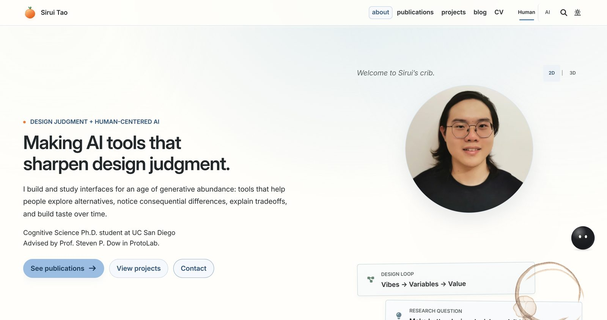
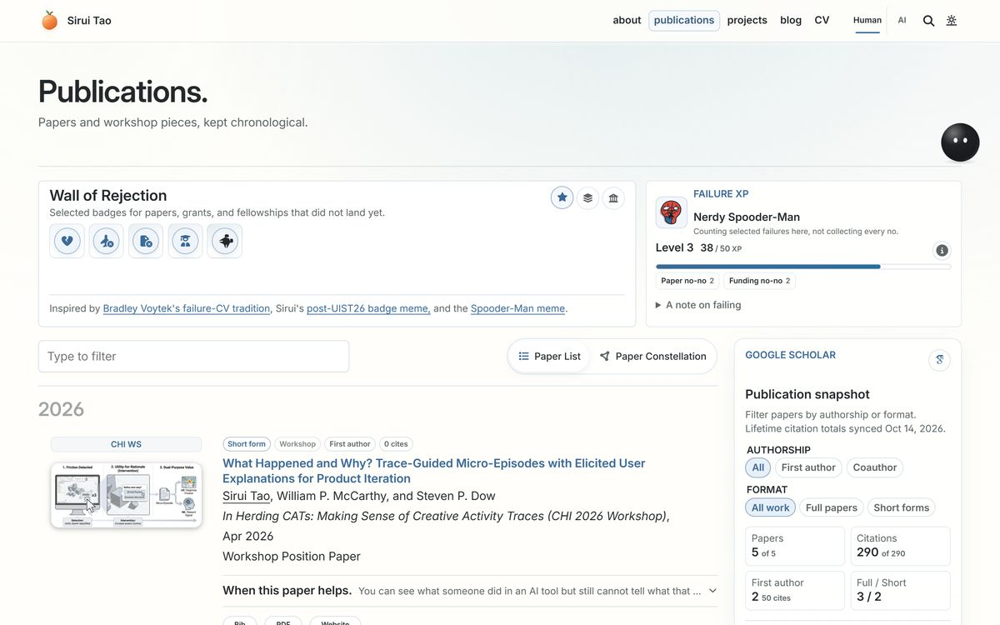
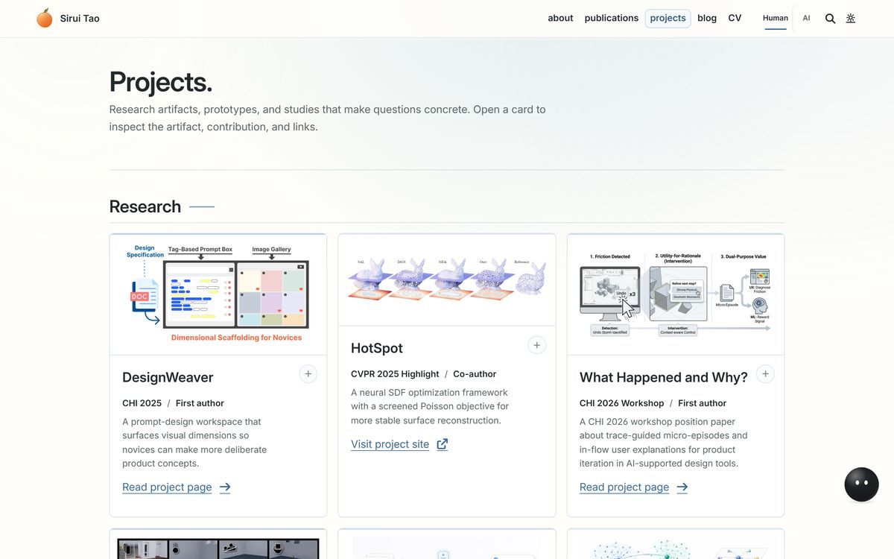
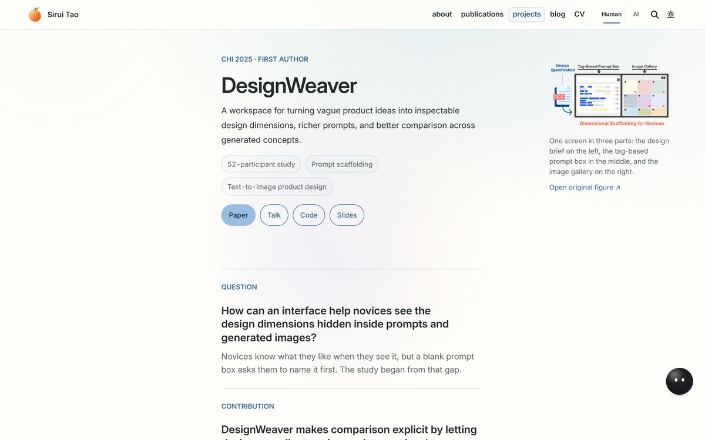
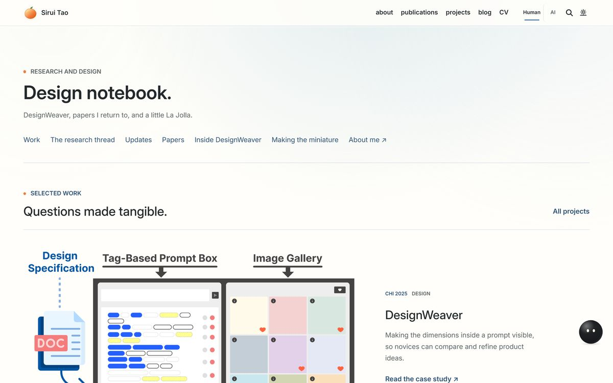
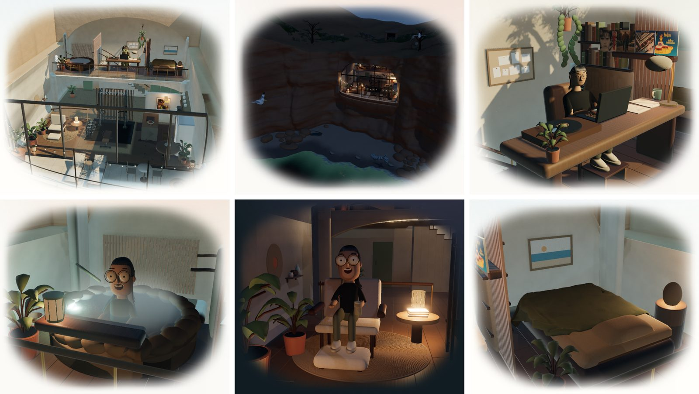
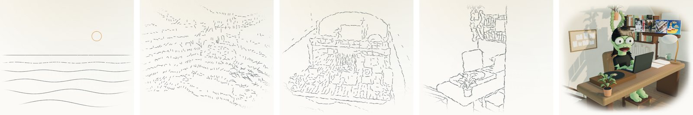
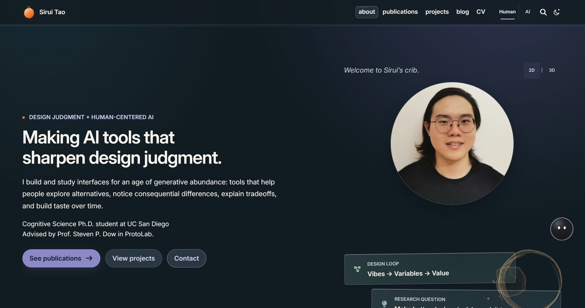
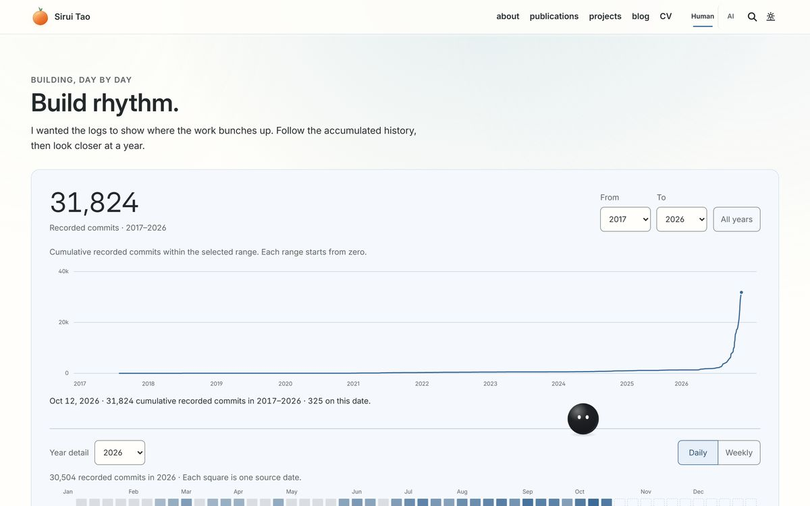

# Sirui Tao · dylantao.github.io

The source of [dylantao.github.io](https://dylantao.github.io/): my research portfolio as a Cognitive Science Ph.D. student at UC San Diego (advised by Steven P. Dow in [ProtoLab](https://protolab.ucsd.edu/)), and a small inhabited 3D home on the La Jolla coast that you can wander through.

[](https://github.com/DylanTao/dylantao.github.io/actions/workflows/deploy.yml)
[](https://github.com/DylanTao/dylantao.github.io/actions/workflows/visual-regression.yml)

<p align="center">
  <a href="https://dylantao.github.io/"></a>
</p>

## Table of contents

<!--ts-->

- [Sirui Tao · dylantao.github.io](#sirui-tao--dylantaogithubio)
  - [Table of contents](#table-of-contents)
  - [What's on the site](#whats-on-the-site)
    - [Research](#research)
      - [Publications](#publications)
      - [Projects and case studies](#projects-and-case-studies)
      - [Design notebook](#design-notebook)
    - [The coastal home in 3D](#the-coastal-home-in-3d)
      - [Things to try](#things-to-try)
      - [How it is made](#how-it-is-made)
      - [While it loads](#while-it-loads)
    - [Smaller things](#smaller-things)
  - [How it's built](#how-its-built)
    - [Stack](#stack)
    - [Repository map](#repository-map)
    - [The 3D pipeline](#the-3d-pipeline)
  - [Working on it](#working-on-it)
    - [Local setup](#local-setup)
    - [Checks](#checks)
    - [Notes for coding agents](#notes-for-coding-agents)
  - [Credits and licenses](#credits-and-licenses)

<!--te-->

## What's on the site

### Research

I build and study interfaces for an age of generative abundance: tools that help people explore alternatives, notice consequential differences, explain tradeoffs, and build taste over time.

#### Publications

[Publications](https://dylantao.github.io/publications/) lists papers and workshop pieces chronologically: [DesignWeaver](https://dylantao.github.io/projects/designweaver/) (CHI 2025, first author), [HotSpot](https://dylantao.github.io/projects/hotspot/) (CVPR 2025), [Physion](https://dylantao.github.io/projects/physion/) (NeurIPS 2021) and Physion++ (CogSci 2023), and a CHI 2026 workshop paper on trace-guided micro-episodes. Next to the list sit a Google Scholar snapshot with filters, a Wall of Rejection for the papers and grants that did not land, and [Paper Constellation](https://dylantao.github.io/projects/paper-constellation/), a second way to browse the same papers by their recurring research threads.

#### Projects and case studies

[Projects](https://dylantao.github.io/projects/) holds research case studies (question, artifact, contribution, evidence, links) and smaller experiments. Cards open in place, so you can read a preview without losing your spot.

<table>
  <tr>
    <td width="50%"><a href="https://dylantao.github.io/publications/"></a></td>
    <td width="50%"><a href="https://dylantao.github.io/projects/"></a></td>
  </tr>
  <tr>
    <td><a href="https://dylantao.github.io/projects/designweaver/"></a></td>
    <td><a href="https://dylantao.github.io/design-lab/"></a></td>
  </tr>
</table>

#### Design notebook

The [design notebook](https://dylantao.github.io/design-lab/) collects DesignWeaver, the papers I return to, and notes on building the site itself. The site's own design rules live in [`WEBSITE_DESIGN_HEURISTICS.md`](WEBSITE_DESIGN_HEURISTICS.md).

### The coastal home in 3D

Switch the homepage desk from **2D** to **3D** and the portrait opens into an imagined two-storey home carved into a sandstone cliff above a La Jolla beach, glazed across its cave mouth and opening onto a terrace over the sea. Sirui (in one of five character styles) follows a daily routine on La Jolla time: working in the study, coffee in the kitchen, the gym, a soak in the onsen, sleep. Rabbits, sea lions, seals, a raccoon, gulls and sandpipers live on the coast outside.

<p align="center">
  
</p>

#### Things to try

- **Zoom out past a room** to see the whole house, then the coast; zoom back in to land in the room under the pointer. On a trackpad, pinch (⌘/Ctrl + scroll) works without clicking first.
- **Drag** to look around; **Shift-drag**, right-drag or two fingers to move.
- In the whole-house view, **click a room** (or press 1–6) to visit it.
- **D** discovers a record card from the desk, **N** visits the coastal neighbours, and **Escape** returns to the study.
- Visit at different hours: the sun, the routine and the lights follow La Jolla time. The glass doors to the terrace stand open by day; at dusk a festoon comes on over the terrace, then the fire bowl, and indoors the lamps brighten wherever Sirui is. Around midday a light well drilled from the clifftop throws a beam of sun into the onsen.

#### How it is made

Every model is original geometry written as Blender Python scripts: the cliff, the house and its furniture, five character rigs and their daily activity animations, the bedding fitted to each sleeping character, and the wildlife. The browser adds the moving light: a physical sun and sky for La Jolla, baked bounce light, a traced light field, a simulated onsen surface and its steam, layered Pacific waves with swash and foam, hair and skin shading, and the light well's beam, path-traced from the shaft walls each time the sun moves. The [Graphics Lab](https://dylantao.github.io/projects/graphics-lab/) lists each technique with the papers it adapts and newer ones to try. The [scene brief](docs/homepage-desk-scene-brief.md) holds the design contract, and [`artwork/coastal-home/PROVENANCE.md`](artwork/coastal-home/PROVENANCE.md) records how each asset was made.

#### While it loads

The empty scene fills with a pen sketch that follows the loading work: the sea with today's sun or moon, then the cliff, the cut-away house and the room you are about to see. On the first frame the strokes settle onto the render's own edges as it fades in. The drawings are traced from the house's geometry.

<p align="center">
  
</p>

### Smaller things

- **Time of day.** The site follows the clock through four themes (morning, noon, afternoon, evening). The sun arc in the navigation bar picks any hour, and the 3D home's sun and routine move with it; the same panel holds a sitewide Pause motion switch.
- **[duh & P](https://dylantao.github.io/projects/pip/).** A soft black dot and a curious little robot share the pages. You can pick duh up, toss it, or let it sleep.
- **[Light Paths in the Onsen](https://dylantao.github.io/projects/light-paths/)** races path tracing against Metropolis light transport in your browser, on the sunlight the light well bends through the onsen's water, scored against a 24-minute reference.
- **A coffee ensō** on the homepage desk: the ring a mug left, drawn as one brush stroke that lies beneath the paper slips, draws itself in, and sometimes closes with a heart. New on every visit.
- **[Build Rhythm](https://dylantao.github.io/github-activity/)** shows when I build: daily code activity by source, read for cadence rather than as a score.
- **Human / AI** in the navigation switches to a plain, source-linked profile written for language models, and **⌘K** opens a command palette.

<table>
  <tr>
    <td width="50%"></td>
    <td width="50%"><a href="https://dylantao.github.io/github-activity/"></a></td>
  </tr>
</table>

## How it's built

### Stack

- **[Jekyll](https://jekyllrb.com/) on GitHub Pages**, starting from the [al-folio](https://github.com/alshedivat/al-folio) v1 starter. al-folio's runtime ships as plugin gems (`al_folio_core`, `al_search`, `al_math`, and others); this repository adds the site's own content, layouts, styles, scripts and assets, and tracks every file it overrides from a gem in [`.al-folio-overrides.yml`](.al-folio-overrides.yml).
- **[Three.js](https://threejs.org/) r164** (vendored) for the 3D home and the footer coast, **GSAP** for the scroll-driven pieces, and plain JavaScript modules elsewhere.
- **[Blender](https://www.blender.org/) 4.5 LTS** for every 3D model, driven entirely by Python scripts in [`bin/`](bin/).
- **[Playwright](https://playwright.dev/)** for rendered checks in Chromium and WebKit, plus Python and Node unit tests.

### Repository map

| Path                                                           | What lives there                                                                      |
| -------------------------------------------------------------- | ------------------------------------------------------------------------------------- |
| `_pages/`, `_projects/`, `_posts/`, `_bibliography/`, `_data/` | Site content: pages, case studies, blog posts, papers and data                        |
| `_layouts/`, `_includes/`, `_sass/`                            | Templates and styles (site-owned, plus tracked overrides of plugin files)             |
| `assets/js/home-scene/`                                        | The 3D home's runtime: controller, lighting, water, steam, characters, loading sketch |
| `assets/models/home/`                                          | Exported, Draco-compressed models and the scene manifest                              |
| `bin/`                                                         | Blender build, refresh, bake and export scripts, capture tools and site maintenance   |
| `artwork/coastal-home/`                                        | Editable Blender sources, provenance and measured reviews                             |
| `docs/`                                                        | Design briefs, evidence write-ups, the studio log, and the upstream al-folio guides   |
| `test/`                                                        | Python and Node unit tests, and the Playwright visual suites in `test/visual/`        |

### The 3D pipeline

The house is authored by [`bin/build_coastal_home.py`](bin/build_coastal_home.py) and its helper modules, then refined in place by focused `bin/refresh_coastal_*.py` scripts (bedding, decoration, the light well, materials). [`bin/bake_coastal_light.py`](bin/bake_coastal_light.py) bakes Cycles ambient occlusion and bounce light into vertex colours, [`bin/optimize_coastal_exports.py`](bin/optimize_coastal_exports.py) writes compact Draco GLBs, and [`bin/review_coastal_models.py`](bin/review_coastal_models.py) measures contacts on the actual posed meshes before anything ships. Each script's header gives its exact command.

## Working on it

### Local setup

You need Ruby with Bundler, Node.js with npm, and (for the integration scripts) Git Bash or WSL. From the repository root on Windows PowerShell:

```powershell
bundle install
npm.cmd ci
bundle exec jekyll serve
```

Or run the checked-in Docker setup, which serves the site at `http://localhost:8080/`:

```powershell
docker compose up -d
curl.exe -fsS http://127.0.0.1:8080/ | Out-Null
```

### Checks

```powershell
npm.cmd run lint:prettier
npm.cmd run lint:style-contract
python -m unittest discover -s test -p "test_*.py"
bundle exec jekyll build --baseurl /al-folio
npx.cmd playwright install chromium webkit
npm.cmd run test:visual:iterate   # one route, one viewport, while designing
npm.cmd run test:visual           # the full rendered suite, before release
```

The visual suites cover the public routes and the WebGL scene at four viewports, in light and dark themes, with keyboard focus and reduced motion. [`AGENTS.md`](AGENTS.md) lists the full validated command set and which evidence each kind of change needs.

### Notes for coding agents

Start from [`AGENTS.md`](AGENTS.md) (Claude Code reads it through [`CLAUDE.md`](CLAUDE.md)). It routes work between this repository and the al-folio plugin gems ([`docs/BOUNDARIES.md`](docs/BOUNDARIES.md)) and points to the repo-local skills for design critique, writing voice and the desk scene.

## Credits and licenses

- The site began from **[al-folio](https://github.com/alshedivat/al-folio)** by Maruan Al-Shedivat and its contributors, itself based on [\*folio](https://github.com/bogoli/-folio) by Lia Bogoev, both under the MIT License; this repository keeps that [license](LICENSE). The upstream setup and customization guides remain in [`docs/`](docs/README.md).
- Three.js and its addons (MIT), Google's Draco decoder (Apache-2.0), GSAP, and the Inter and Newsreader fonts (SIL OFL) keep their own licenses; their versions and hashes are recorded next to the vendored files.
- The 3D home, its characters and wildlife are original work for this site; [`artwork/coastal-home/PROVENANCE.md`](artwork/coastal-home/PROVENANCE.md) records how each asset was made and which generated studies guided it.
