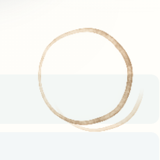
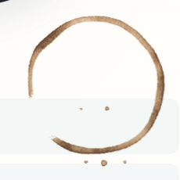

# Coffee procedural checkpoint, October 28, 2026

The previous stain read as two pale, nearly uniform outlines. This candidate paints a single deposited wash: a sharp brown outer edge, a softer irregular inner edge, three pooled lobes, broad mottling, secondary fine wicking and a torn lower-left arc. Two small drops sit inside the footprint and three varied drops lie below it. The center remains transparent. The larger footprint is raised slightly on desktop and further on phone to keep the drops clear of the slips' words.

This is a procedural Canvas treatment of Sirui's reference description, not a fluid simulation or a claim of photorealism. The reference's continuous amber/brown deposit matters more than adding random specks. [Deegan et al.](https://www.nature.com/articles/39827) informed perimeter accumulation; [Curtis et al.](https://grail.cs.washington.edu/wp-content/uploads/2015/08/curtis-1997-cgw.pdf), especially their descriptions of edge darkening, granulation and paper structure, informed the visual effects. This code does not implement their shallow-water or Kubelka–Munk models. No reference pixels, downloaded clipart or generated image assets ship.

## Rendered comparison

| State                    | Before                               | Candidate                              |
| ------------------------ | ------------------------------------ | -------------------------------------- |
| Full desktop hero        | [Before](before-desktop-hero.png)    | [Candidate](after-desktop-hero.png)    |
| Actual composited detail |  |  |
| Full phone hero          | [Before](before-phone-hero.png)      | [Candidate](after-phone-hero.png)      |
| Phone detail             | [Before](before-phone-detail.png)    | [Candidate](after-phone-detail.png)    |

The baseline is the complete existing production preview from pinned `759a3b58b`. Its generated desktop raster exactly matches the pinned raw baseline captured before editing. The candidate captures use the complete new Jekyll production build, including all normal assets. This compact archive retains representative desktop and phone views. The additional evening, laptop and tablet checkpoint images remain on local checkpoint branch `codex/coffee-procedural-checkpoint` and in ignored QA.

[Desktop native RGBA](after-desktop-native.png) and [phone native RGBA](after-phone-native.png) are the actual generated bitmaps before CSS opacity/blending. Their transparent center may appear black in an image viewer; judge color and placement from the composited detail and full hero. All captures and their source-response hashes have matching JSON files, made by [capture.cjs](capture.cjs). The final [binding record](source-binding.json) separately confirms raw HTTP bytes against the built files. Chromium's response-body API strips the main CSS's three-byte UTF-8 BOM; that normalization is recorded explicitly. The production coffee script matches byte-for-byte.

The [sandy outline attempt](rejected-sandy.png) was rejected because granulation supplied the whole body. The [overly smooth attempt](rejected-smooth.png) had a beveled, airbrushed reading. These retained images document the failure modes; the complete experimental captures and build logs remain in ignored `.jekyll-cache/visual-qa/coffee-2026-10-28/`.

## Verification and cost boundary

- The existing public coffee case passed on desktop and phone against production. It samples the actual PNG alpha mask, including faint alpha ≥8 and every drop, against both slips' text. Seeds `52`, `7`, `31` and `103` stay inside the clipping column and clear of words. This replaces the old approximate-annulus calculation without weakening the safety requirement.
- The same seed replays exactly; other seeds differ. At least 98% of the center must be transparent; the saved final captures measure 99.55% or more. Tests retain the on-top layer, click-through, multiply blend, no wet layer, no sweeping mask and reduced-motion/theme repaint checks. The original 3.2-second one-time settle is unchanged and finishes; the generated image stays still afterward.
- Scoped `home` checkpoint: four standard viewport cases passed. All 314 Python tests, targeted Prettier, style contract, `git diff --check`, the full `/al-folio` production build and publication/AI-output validation passed.
- The production script is 6,528 bytes; its computed gzip representation is 3,148 bytes. The local preview serves it uncompressed. There is no added image network request: the generated PNG becomes a data URL. Saved desktop/phone bitmaps range from 21,933 to 36,032 bytes.
- The raster remains capped at 512×512. Each of the density and RGBA typed arrays is at most 1,048,576 bytes; that is an array-storage bound, not total browser memory. Density work yields after at most eight scanlines and aims for four milliseconds per idle turn. Initialization, palette conversion and asynchronous PNG encoding do not carry a device-independent wall-clock guarantee. No recurring Canvas animation, RAF loop or timer was added. These were functional captures under shared machine load, not exclusive hardware/startup benchmarks or physical-phone performance evidence.

Only `assets/js/home-coffee-stain.js`, three coffee-only Sass values and the existing focused coffee test block changed outside this review. Hero meaning, controls, portrait, native 3D geometry and global chrome were preserved. Canonical handoff updates, integration, release checks and publishing belong to the coordinator; this review does not record Sirui's taste acceptance.

Coordinator review rejected the material direction after inspecting the production views: the band still resembles a uniformly colored wooden hoop, with regular radial shading and a nearly smooth contour, while the satellite drops form an ellipsis. The richer reference remains unmet. This verified procedural checkpoint is retained as a fallback and comparison, not admitted as the final stain. One original transparent bitmap comparison follows separately.

From the repository root against an owned complete production preview:

```powershell
$env:NO_WEBSERVER='1'; $env:VISUAL_BASE_URL='http://127.0.0.1:4115/al-folio'
npx.cmd playwright test --config test/visual/public.config.js sitewide.spec.js --grep 'coffee ring rests' --project desktop-1440 --project mobile-390 --workers 1
$env:VISUAL_ROUTE_IDS='home'; npm.cmd run test:visual:checkpoint
node artwork/coastal-home/reviews/coffee-2026-10-28/capture.cjs after-desktop 1440 noon 52
# COFFEE_REVIEW_URL selects another owned preview; positional arguments select name/width/theme/seed.
```
