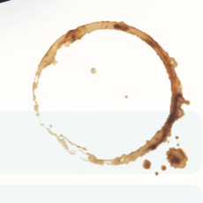

# Coffee pigment review, October 28, 2026

The preferred stain uses an original generated transparent pigment texture. Its continuous amber wash, pooled brown deposits, irregular contour and faded lower-left arc read more convincingly as dried coffee than the previous paired circles or the procedural checkpoint. The complete irregular drop group is retained. The coordinator reviewed desktop, dark and phone comparisons and approved this direction for integration; this does not record Sirui's final taste acceptance.

| State             | Baseline                             | Preferred production                       |
| ----------------- | ------------------------------------ | ------------------------------------------ |
| Full desktop hero | [Before](before-desktop-hero.png)    | [Preferred](preferred-desktop-hero.png)    |
| Composited detail |  |  |
| Full phone hero   | [Before](before-phone-hero.png)      | [Preferred](preferred-phone-hero.png)      |
| Phone detail      | [Before](before-phone-detail.png)    | [Preferred](preferred-phone-detail.png)    |

The baseline is the complete production preview from pinned `759a3b58b`. Its generated desktop PNG matches the pinned raw baseline captured before editing. The preferred captures use the complete frozen Jekyll production build, with the real asset request and no raw-source overrides or route-specific omissions. [Desktop evening](preferred-dark-hero.png), [phone evening](preferred-phone-dark-hero.png), [1280×800](preferred-laptop-hero.png) and [768×1024](preferred-tablet-hero.png) retain the full surrounding composition. [Phone DPR 3 detail](preferred-phone-dpr3-detail.png) and its [native RGBA](preferred-phone-dpr3-native.png) show the material at higher sampling density in Chromium mobile emulation, not on a physical phone.

## Source and material

The built-in `image_gen` tool generated one original pigment bitmap without input images. It did not edit or copy Sirui's screenshot. The [exact prompt](raster-comparison/PROMPT.txt), [unmodified 1254×1254 RGBA source](raster-comparison/source.png) and [provenance](raster-comparison/provenance.json) are retained. The original tool filename is `exec-6082f9be-f3ea-474b-8272-3a234cb94e40.png`, saved by Codex under `generated_images/01a1817b-9543-76e1-96ec-ff58ecd31beb/`; the tool did not expose a model selector/version. This is generated pigment, not a photograph or a fluid simulation.

The public [512×512 WebP](../../../../assets/img/home/coffee-deposit-20261028-c91b57ee8c.webp) is a uniform resize and format conversion only: quality 90, alpha quality 100, method 6. No pigment marks were trimmed or repainted. Its exact size is **50,038 bytes**, SHA-256 `c91b57ee8cb7d0818f7d93e46e917a8e59ceae87e71369e0c5a1f43a2e1210a9`. The large lower-right drop remains complete and clear of the text.

The base pigment topology is fixed. Each visit varies seeded placement, small affine proportions and a restrained tint; `?coffeeSeed=52` reproduces the same result. The real alpha mask is inset before rotation, with a slightly larger phone-side inset. Both the transparent center and the paper beneath the band remain visible. The existing multiply layer and 3.2-second once-only settle remain; reduced motion shows the dry mark immediately.

The texture request starts when the slips approach the viewport. Its URL resolves relative to the classic coffee script, preserving the production `/al-folio` baseurl. Decoding is asynchronous. If decoding fails or the 1.5-second selection budget expires, the deterministic procedural version supplies the decoration. Selection locks, so a delayed successful request cannot replace an already visible fallback. Theme changes repaint once; there is no recurring Canvas animation or rendering loop.

## Verification and cost boundary

- The existing focused public coffee case passed on Chromium desktop/phone (2 cases) and WebKit touch/DPR 3 (1 case). It checks actual PNG alpha ≥8 against both slips' text, not an approximate annulus. Seeds `52`, `7`, `31` and `103` stay clear; same-seed PNGs replay exactly, distinct seeds differ. The full permitted rotation/translation/scale corners tested in both viewport cases keep the real pigment inside the clipping column. This caught and corrected phone-side drop clipping without weakening the clearance threshold.
- The case retains on-top layering, click-through, multiply blending, no wet/mask layer, reduced-motion and theme-repaint assertions. The live 3.2-second settle finishes. Invalid-image and deliberately delayed-response fixtures verify functional fallback and no late visual swap.
- The scoped home checkpoint passed at 1440×1000, 1280×800, 768×1024 and 390×1000. The complete `/al-folio` production build, publication/AI-output validator, 314 Python tests, style contract, targeted Prettier and `git diff --check` passed. All seven retained preferred captures have no page errors and report `source: raster`.
- [The binding record](preferred-source-binding.json), produced by [verify-binding.py](verify-binding.py), compares raw HTTP bytes with built JS, CSS and WebP for each capture. The HTML coffee cache version matches the raw source MD5. Chromium's response-body API removes the CSS's three-byte UTF-8 BOM; the normalized and raw hashes are explicitly separated. The texture and compiled script match byte-for-byte.
- The raw coffee source is 18,606 bytes; the compiled script is 7,661 bytes, with a **computed** gzip representation of 3,619 bytes. The local preview serves it uncompressed. The preferred material adds one near-view 50,038-byte image request; the generated CSS PNG is a data URL, 34,385–55,018 bytes in the saved states. The measured center-clear fraction is at least 99.227% at alpha below 8, exceeding the retained 98% threshold.
- The generated raster remains capped at 512×512. Each full RGBA or fallback density typed array is at most 1,048,576 bytes; multiple arrays, Canvas backing stores, the decoded image and PNG strings coexist, so this is not a total-memory claim. The preferred path bypasses fallback density generation. The fallback yields after at most eight scanlines and aims for four milliseconds per idle turn. The 1.5-second budget selects the fallback; it does not promise a device-independent completion time. These captures ran under shared machine load, with no exclusive hardware timing or physical-device performance claim.

## Retained attempts and scope

The procedural checkpoint `062eeaa49` remains on a local checkpoint branch and is described in [PROCEDURAL.md](PROCEDURAL.md). Its material was rejected as a smooth wooden hoop with aligned drops despite passing functional tests. It remains a loading fallback, not the preferred visual direction. [Sandy residue](rejected-sandy.png), [overly smooth shading](rejected-smooth.png) and the procedural production comparisons preserve the main failures. Earlier raw preview frames and duplicate original bitmap copies remain in ignored `.jekyll-cache/visual-qa/coffee-2026-10-28/retained-preview-comparisons/`.

Only the coffee script, four coffee-only Sass values, the existing focused coffee test block, one pigment asset and this review changed. Hero meaning, portrait, controls, native 3D geometry and global chrome remain outside this change. Canonical handoff updates, integration, final release checks and publishing belong to the coordinator.

From the repository root against an owned complete production preview:

```powershell
$env:NO_WEBSERVER='1'; $env:VISUAL_BASE_URL='http://127.0.0.1:4115/al-folio'
npx.cmd playwright test --config test/visual/public.config.js sitewide.spec.js --grep 'coffee ring rests' --project desktop-1440 --project mobile-390 --workers 1
npx.cmd playwright test --config artwork/coastal-home/reviews/coffee-2026-10-28/webkit.config.cjs sitewide.spec.js --grep 'coffee ring rests'
$env:VISUAL_ROUTE_IDS='home'; npm.cmd run test:visual:checkpoint
node artwork/coastal-home/reviews/coffee-2026-10-28/capture.cjs preferred-desktop 1440 noon 52
python artwork/coastal-home/reviews/coffee-2026-10-28/verify-binding.py --site .jekyll-cache/visual-qa/coffee-2026-10-28/preferred-site
# COFFEE_REVIEW_URL selects another owned preview; COFFEE_DPR sets sampling density.
```
