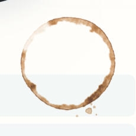
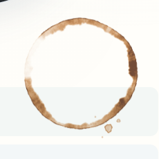
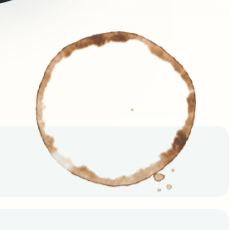
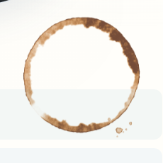
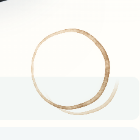
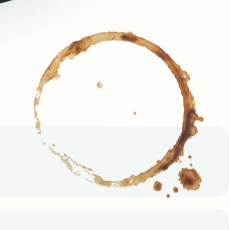

# Generative coffee candidate, October 28, 2026

Each visit now generates its own cup contact contour, broken arcs, amber wash, concentrated outer edge and unequal complete drops. The old preferred bitmap is used only when Canvas or encoding fails. The coordinator selected this bounded mesoscopic pigment version for verification; **Sirui's appearance acceptance remains open**. The procedural material is authored deposition, not a fluid simulation or a photograph.

The complete own production build is pinned to base `e91430e5d85c86607750a351ed7739d184a0c2be`. The stable previews are [seed 31](http://127.0.0.1:4132/al-folio/?coffeeSeed=31) and [seed 52](http://127.0.0.1:4132/al-folio/?coffeeSeed=52). `/_coffee-preview.json` identifies the actual compiled files. These final candidate captures use the complete site without source overlays or route/image omissions; coordinator integration needs its own final build.

| Same placement, settled    | Seed 52                                              | Seed 31                                              | Seed 7                                              | Seed 103                                              |
| -------------------------- | ---------------------------------------------------- | ---------------------------------------------------- | --------------------------------------------------- | ----------------------------------------------------- |
| CSS-size detail            |       |       |        |      |
| Native transparent pigment | [1024 PNG](captures/candidate-desktop-52-native.png) | [1024 PNG](captures/candidate-desktop-31-native.png) | [1024 PNG](captures/candidate-desktop-7-native.png) | [1024 PNG](captures/candidate-desktop-103-native.png) |

All four native density fields, RGBA results and drop geometries differ before any CSS transform. Same-seed generation replays exactly. [Desktop hero](captures/candidate-desktop-31-hero.png), [evening detail](captures/candidate-dark-31-detail.png), [phone DPR 3 hero](captures/candidate-phone-31-hero.png), [phone detail](captures/candidate-phone-31-detail.png) and [phone evening](captures/candidate-phone-dark-31-detail.png) retain the surrounding composition. The phone is browser emulation, not a physical device.

## Material comparisons and retained controls

| Matched CSS size and placement | Older 759 procedural material                             | Previously published fixed raster                           | New seeded material                              |
| ------------------------------ | --------------------------------------------------------- | ----------------------------------------------------------- | ------------------------------------------------ |
| Detail                         |  |  |  |

The first two columns deliberately substitute only an archived pigment image over the identical final candidate CSS and placement. Their JSON identifies that substitution; they are material controls, not final route acceptance. **The older 759 prototype is not Sirui's original screenshot.** The fixed raster was an original generated image described in the [prior review](../coffee-2026-10-28/README.md). Neither control copies the user's screenshot. The screenshot's visible translucent amber band, sharp uneven contact line, heavier pooled sectors and tapered dry arc remain the visual benchmark. The pale horizontal strip through the centre is the actual page/card underneath.

The earlier high-resolution direction was too faint and powdery at CSS size. A coherent amber body and pinned outer line corrected those specific shortcomings. The retained [pinned-only 52](controls/pinned-only-52-detail.png) / [31](controls/pinned-only-31-detail.png) control uses the frozen pre-meso source and its [compiled script](controls/pinned-only-compiled.min.js), explicitly intercepted over the complete candidate site. The selected change adds just one intermediate pigment grid, about 0.7–1.2 CSS pixels at the intended size. It modulates wash by 0.75–1.25 and the pinned line by 0.9–1.1; it adds no drops or uniformly furry fringe. Earlier thin/amber/pinned iterations remain in the worker's ignored `.jekyll-cache/visual-qa/generative-coffee-2026-10-28/attempt-01` through `attempt-04` and accompanying named captures.

The actual-alpha family sweep found a complete satellite beyond the unchanged clipping tolerance in seed 45. The [pre-safety source](controls/pre-safety-home-coffee-stain.js) and [reproduced failing witness](controls/reproduced-pre-safety-bounds.json) retain normalized maximum x `1.002358529298921`, above `1.0009`. The kept fix projects each entire drop centre into a circular inset before rasterization, including its irregular extent. It neither cuts alpha nor rerolls the unrelated ring field. The [same 64-seed sweep](family-bounds.json) now passes with maximum `0.9511157542235631`. This is sampled family evidence, not a claim of exhaustive random-seed coverage.

## Motion and reliability

Two seed-derived density fields share a fixed footprint: a dilute wet wash and a sharper deposited field. They crossfade once over 3.2 seconds after entering view. [Wash](deposition/wash-native.png), [deposited pigment](deposition/dry-native.png) and [phase samples](deposition/phases.json) retain their distinct spatial distributions. The [0 ms](deposition/phase-0ms.png), [1600 ms](deposition/phase-1600ms.png) and [3199 ms](deposition/phase-3199ms.png) images seek the real CSS animations explicitly for inspection; they are not elapsed-time measurements. No whole-ring rotation, scaling, loader sweep or recurring Canvas loop is animated.

Reduced motion uses only the deposited field. The public global pause settles it immediately; resume does not replay it. The wet field/image is released after settling. Theme changes reuse the same density and exact alpha, changing only pigment colour. The layer stays above the slips, uses multiply blending, and has no pointer events.

Normal generation requests no pigment bitmap. Starved idle callbacks use the timer backstop; a null asynchronous encoder uses the local PNG path. An encoder exception selects the unchanged, complete 512-pixel raster explicitly as `raster-fallback`. The public tests retain real alpha-mask/text/column checks for that fallback too. No network generation, API or credentials are involved.

## Binding, cost and verification

[Source binding](source-binding.json) checks the four [frozen inputs](frozen-inputs.json), source MD5 in compiled HTML, raw HTTP bytes against built JS/CSS, response hashes, native PNG hashes and render hashes. The seven final captures have no page/console errors, no script/raster overrides and only the expected coffee JS/CSS binding responses. CSS's three-byte UTF-8 BOM is explicitly separated from Chromium's normalized response body. The build's module receipt contains **168 compiled modules**.

The runtime source is **23,407 bytes**, LF SHA-256 `1b25425562d142a2fec52c3facd1abc00a499494be60c67d38c5f81590957dc6`. The compiled script is **10,927 bytes**, SHA-256 `835d6fa04d6a1260cbf93a1f5e9f29b527f2b3f200fc141ccbee090ac712b4c7`, with **4,886 computed gzip bytes**. The local preview serves it uncompressed. Ordinary visits no longer fetch the 50,038-byte fixed pigment asset; that unchanged asset remains available for recovery. This is an asset accounting statement, not an overall load-time improvement claim.

The actual final desktop DPR 1 and phone DPR 3 captures both generate **1024×1024**, for 214.391 and 163.797 CSS-pixel footprints respectively. Higher CSS/DPR demand selects 1536, with a hard 1536 cap. The focused CPU stress test really allocates and generates that larger field. At 1536, density plus reusable RGBA typed arrays are bounded at **18 MiB dry / 27 MiB live**, plus **81,920 profile bytes**. At the captured 1024 size they are **8 / 12 MiB**. Canvas/browser stores, JS objects, encoding/decoding, data URLs and driver memory are additional; these bounds are not a total-memory measurement.

The [browser observations](browser-observations.json) and [CPU-only observations](generator-observations.json) are retained under shared machine load, including coordinator activity. In the seven dry browser captures, density work took 98.6–111.4 ms across 60–63 chunks, with largest observed chunk 4.0–4.7 ms. Palette work took 11.3–13.4 ms; Canvas put took 1.5–2.0 ms and PNG encoding/read wall time 39.8–45.8 ms. The observed ready interval was 1.83–1.95 seconds, including idle scheduling; this is not a latency target or benchmark. Generated PNGs were 296,320–319,105 bytes, retained locally as data URLs. CPU-only stress observed a 10.918 ms maximum chunk. The four-millisecond check is a yield target checked between rows, not a hard scheduler guarantee. Density is bounded to 24 rows per turn, palette to 32, profile to 256 bins; an idle callback and coalesced timer service one next turn. There are no isolated device timings, FPS claims or physical-phone measurements.

The verification packet records the complete production build, four-width/light-dark home checkpoint, focused Chromium desktop/phone and WebKit touch/DPR 3 coffee cases, four generator tests, 314 Python tests, publication/AI-output validation, style contract and targeted format/diff checks. The focused case checks actual alpha ≥8 with the unchanged one-pixel text/column margin, four ordinary seeds, seed 52's permitted placement corners, replay, independent generation, theme-stable alpha, live deposition, actual settled marker/no wet layer, global pause, reduced motion and failure/recovery. The smallest measured centre-clear fraction in the retained final PNGs is **99.924%**, above the unchanged 98% requirement.

Earlier diagnostic failures are retained honestly: missing ImageMagick destination directories, Windows `convert` resolving to the filesystem tool, one phone test that did not scroll the live mark into view, a strict console failure from a font connection on the prototype server, and the real seed-45 overflow. Destination/PATH setup, explicit scrolling, an exclusive single owned HTTP server with a larger request queue, and whole-drop placement resolved those respective failures. No console filter, route omission or threshold relaxation was added. The final motion assertion uses actual DOM/CSS state because `element.getAnimations()` omitted the pseudo-element animations; the visual sampler uses `document.getAnimations()` and records both real animation times.

Only the coffee script, coffee-specific Sass, the existing coffee browser block, one focused test file and this new review change. Canonical docs, global chrome, 3D/native assets, package wiring, coordinator integration and publishing remain root-owned. The metrics refresh is laptop-only under Sirui's current instruction and was not run in this worker.

From the repository root with an owned complete build:

```powershell
$env:NODE_PATH='C:\dev\dylantao.github.io\node_modules'
$env:NO_WEBSERVER='1'; $env:VISUAL_BASE_URL='http://127.0.0.1:4132/al-folio'
node --test test/home-coffee-stain.test.mjs
npx.cmd playwright test --config test/visual/public.config.js sitewide.spec.js --grep 'coffee ring rests' --project desktop-1440 --project mobile-390 --workers 1
npx.cmd playwright test --config artwork/coastal-home/reviews/coffee-generative-2026-10-28/webkit.config.cjs sitewide.spec.js --grep 'coffee ring rests'
$env:VISUAL_ROUTE_IDS='home'; npm.cmd run test:visual:checkpoint
$env:COFFEE_FIXED_PLACEMENT='1'
node artwork/coastal-home/reviews/coffee-generative-2026-10-28/capture.cjs candidate-desktop-31 1440 noon 31
node artwork/coastal-home/reviews/coffee-generative-2026-10-28/capture-deposition.cjs
node artwork/coastal-home/reviews/coffee-generative-2026-10-28/check-family-bounds.cjs
python artwork/coastal-home/reviews/coffee-generative-2026-10-28/verify-binding.py --site .jekyll-cache/visual-qa/generative-coffee-2026-10-28/site-candidate/al-folio
```
