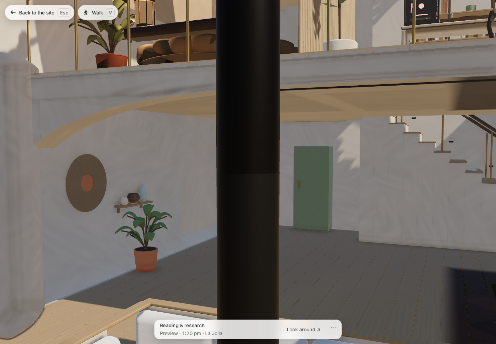
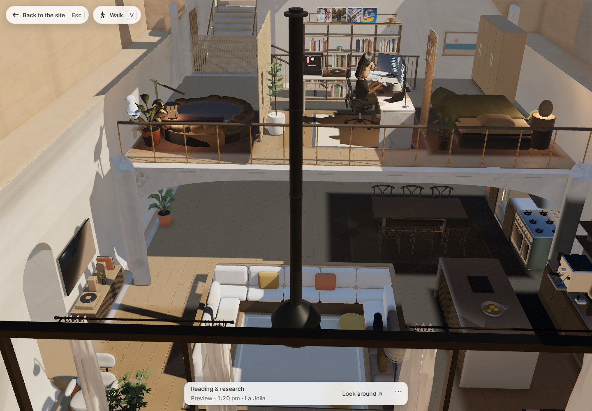
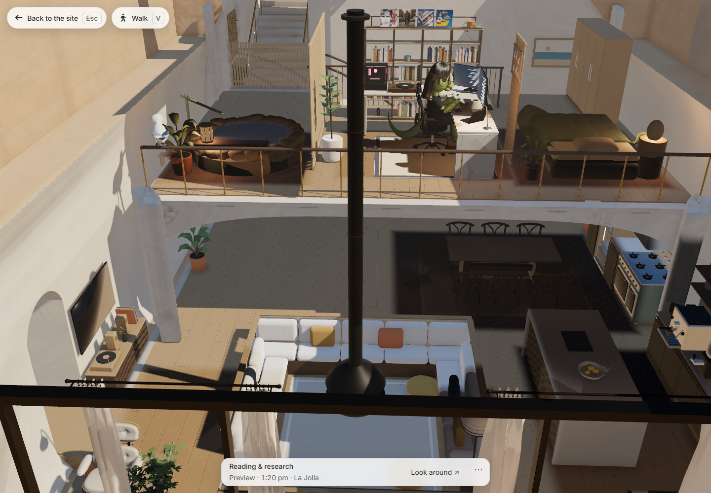

# Fireplace neck joint — October 23, 2026

The retained [earlier lounge image](../../../../../docs/evidence/living-plants-2026-10-23/lounge.png)
shows a real 30 cm gap. The item ended at local height 1.90 m, while the room's
extension begins at 2.20 m above the −0.42 m pit floor. Only the two upper graphite
rings now reach 2.20 m; the room, anchors, canopy, bowl and fire remain unchanged.
The builder's full and focused patch paths use the corrected endpoint.








These are actual Chromium 1440 × 1000, DPR 1 full-screen captures, reviewed directly.
Only the furniture index and the two fireplace GLBs were overlaid on the production
candidate. No pixels were edited, masks added, or scene geometry hidden. The existing
cutaway exposes the upper flue; the foreground glazing rail crosses the lower bowl in
the wide shot. The room and item retain slightly different material shading at their
continuous joint. Avatars differ between sessions; cameras and furniture placement match.

The delivered Draco end planes differ by 0.0001621 mm, and their axes by 0.0401112 mm.
Both radii meet the native 0.10 m radius within the 0.3 mm quantization tolerance.
Substituting the original GLBs makes both geometry tests fail on a 300 mm gap.
Sixteen focused Node tests, targeted Prettier, the style contract, Python compilation
and diff checks pass. Default export is 12,588 bytes; fine is 17,264 bytes.

`acceptance.json` binds the images and served bytes. `asset-preservation.json`
confirms all twenty other GLBs, ten other item records, house source, lounge export
and manifest are unchanged. `native-preservation.json` compares the editable source:
79 of 81 meshes are identical in positions, topology, UVs, vertex colors, material
slots, parents and local transforms; only 64 fine and 32 default neck vertices move.

Reproduce from an installed Blender with six threads:

```text
blender --background --threads 6 --python-exit-code 1 --python bin/build_coastal_furniture.py -- --patch-fireplace-neck
node --test test/coastal-furniture.test.mjs test/coastal-fireplace-joint.test.mjs
node bin/capture_coastal_fireplace_joint.cjs .jekyll-cache/visual-qa/fireplace-joint/fullscreen
```

The capture defaults to the coordinator's production server at port 4153 under
`/al-folio/`; `FIREPLACE_URL` overrides it. A worker can set `NODE_PATH` to a real
dependency installation without adding a junction.
