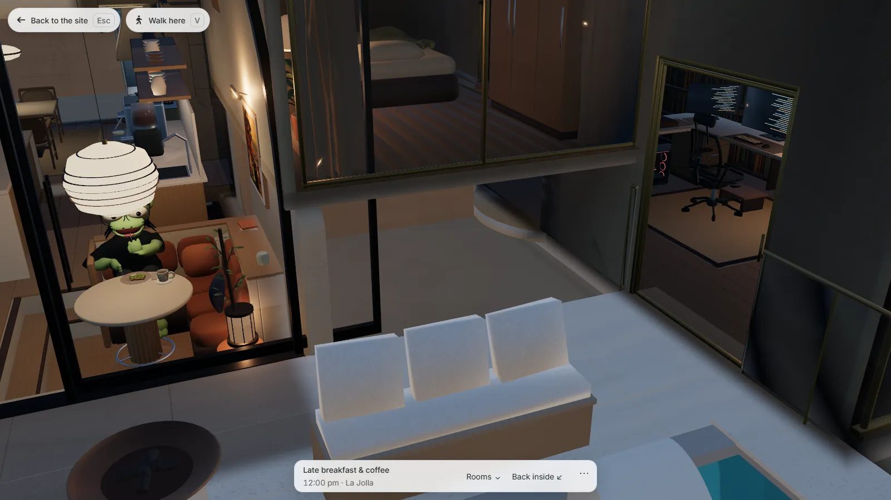
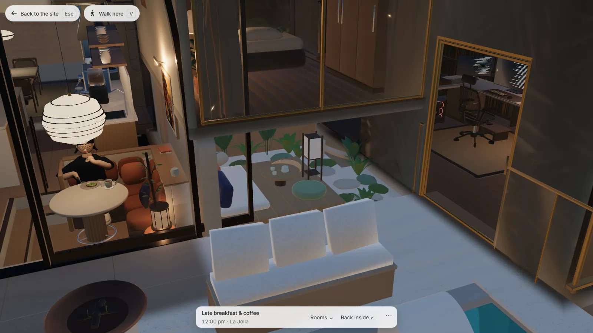
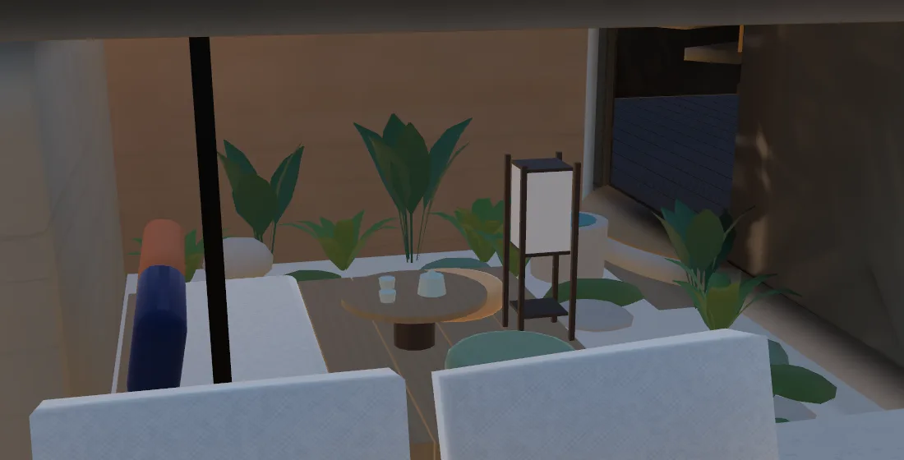
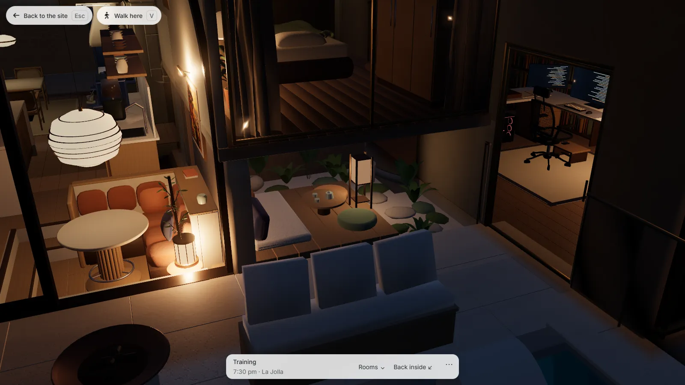
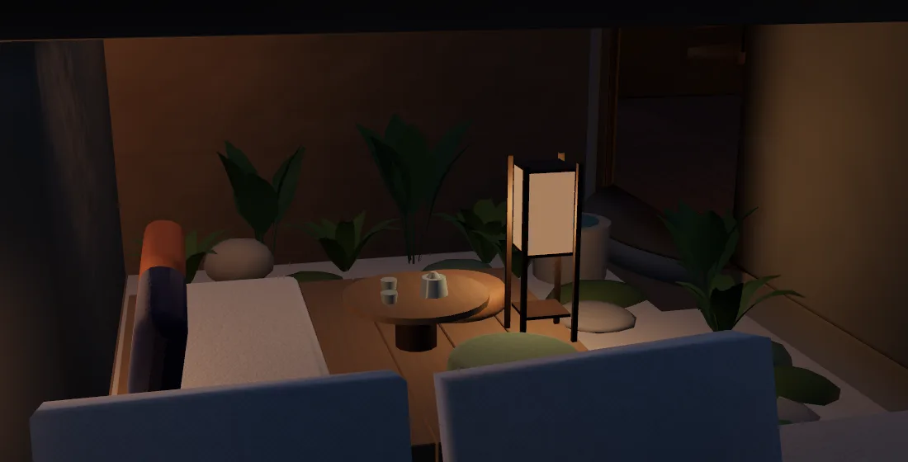

# A court garden under the bedroom

Sirui's November 3 review asked for the empty bay beside the breakfast nook to be filled "with some nice and comfy plant surrounding". The bay is 2.98 m wide, 2.9 m deep and 1.54 m high, one 20 cm step below the pool terrace. Nobody can stand in it, so it is built the way a Japanese house treats such a pocket: a _tsubo-niwa_, a small garden made to be looked into and sat down in.





## What is in it

A low deck of seven pale oak boards runs back from the terrace along the east wall. On it are a linen futon with a terracotta and an indigo bolster, two round floor cushions, a tea table with a celadon pot and two cups, and a standing paper lantern. Three stepping stones lead in from the terrace past a stone basin. Six ferns, three cast-iron plants and seven moss mounds fill the back wall and the west side, over a bed of pale gravel.

Everything is additive: no rock is cut and no existing object moves. `bin/coastal_garden_refuge.py` builds it as 16 objects (one per material, like the rest of the room) with 4,280 triangles. The objects are named `kitchen_garden__*`, so only `room-kitchen.glb` is exported again and the shell keeps its bytes.



## The lantern is a light

The first candidate had a 44 cm lantern at the bay's mouth. At night it was a white box in a dark bay: an emissive material with no light behind it, lower than the table top and two metres from the seats.

The lantern now stands 78 cm tall on the deck between the two cushions. Its lamp is an authored installation point in `assets/models/home/manifest.json` (`installationPoints`, id `tea-garden-lantern`): the house's own room-local light, evaluated only by the materials near it. A ninth warm practical would have added a point light to every lit shader in the house.

- The lamp is on the `steps` schedule: off by day, 0.45 through the dark, like the path lights outside.
- The garden's objects carry `installationGroup = "exterior"`, so they are lit with the terrace the garden opens onto. The paper carries `installationGlow = "tea-garden"`, so the shade glows on the lamp's schedule. Both are custom properties set by the builder and exported as glTF extras. No scene code changed.
- The lamp's box stops inside the rock fin and under the bedroom slab. The living floor, the upper floor and the shell each already carry ten installation points, the shader's limit, and the lamp joins none of them: only `exterior` (now 5 points) and `library` (3).
- The paper is its own material, `garden lantern paper`, with emission 0.6, 0.3, 0.12. The living room's paler washi at the same level saturates to white under the night exposure.





## Numbers

| Item                                     |                Before |                 After |
| ---------------------------------------- | --------------------: | --------------------: |
| House file `coastal-home.blend` (sha256) |           `cb531e38…` |           `5aa3486a…` |
| `room-kitchen.glb` (sha256)              |           `6f8ef82b…` |           `64fbf89f…` |
| `room-kitchen.glb` bytes                 |               253,496 |               294,180 |
| `room-kitchen.glb` gzip bytes            |               148,367 |               169,273 |
| Overlap offenders (native)               |                   939 |                   939 |
| Deep sites over 5 cm (native / decoded)  |             306 / 157 |             306 / 157 |
| Visible z-fighting (native / decoded)    | 0.7686 m² / 1.0794 m² | 0.7686 m² / 1.0794 m² |
| Grazing seam (native / decoded)          |     3.621 m / 4.226 m |     3.621 m / 4.226 m |
| Light bake triangles (ceiling 750,000)   |               731,761 |               736,041 |
| Light cache bytes (ceiling 800,000)      |               712,173 |               712,658 |

The audit records 19 contacts between garden objects and their surroundings. All are resting or rooted contacts under the existing rules (12 support rests, 5 planting roots, 1 one-sided embed, 1 shallow seam) with zero severity, and none is z-fighting in the source or in the decoded delivery.

Before anything changed, exporting the unchanged kitchen with the committed exporter reproduced the shipped `room-kitchen.glb` byte for byte, so every difference after the install is the garden.

## Limits

- The lantern does not light the rock above and behind the garden. The slab and the cliff belong to the `architecture` receiver, which is full. From the usual high view that reads as a lit garden against dark stone. From a low camera the unlit ceiling just above the lantern is wrong.
- Installation lights cast no shadows, so the plants do not shade one another under the lantern.
- Nobody uses the garden. It has no activity anchor, and at 1.54 m nobody could stand up in it.
- The light bake collects 736,041 triangles against a ceiling of 750,000. The next geometry added inside a light region needs that ceiling looked at first.
- Judged by Claude on desktop frames at four hours of one day. Not seen on a phone, and not reviewed by Sirui.

## Reproduce

From the house file before this delivery (`cb531e38…`):

```bash
blender -b --factory-startup --python-exit-code 1 artwork/coastal-home/coastal-home.blend \
    --python bin/coastal_garden_refuge.py -- --install
blender -b --factory-startup --python-exit-code 1 --python bin/bake_coastal_light.py -- \
    --source=artwork/coastal-home/coastal-home.blend --prefixes=kitchen_garden \
    --report=artwork/coastal-home/reviews/baked-light.json
# export room-kitchen through bin/optimize_coastal_exports.py with --only=room-kitchen --active-geology-ao,
# under the geology custody adapter (bin/coastal_geology_export_custody.py)
blender --background --factory-startup --python-exit-code 1 --python bin/build_coastal_perch_support.py
blender --background --python-exit-code 1 --python bin/audit_coastal_overlaps.py -- --out=<native.json>
blender --background --python-exit-code 1 --python bin/audit_coastal_overlaps.py -- --delivered=1 --out=<delivered.json>
python bin/summarize_coastal_overlaps.py --audit=<native.json> --delivered=<delivered.json> --before=<the previous committed overlap-audit.json>
COASTAL_CACHE_URL=<preview>/ node bin/bake_coastal_static_light.cjs
VISUAL_BASE_URL=<preview> node bin/build_loading_sketch.cjs
```

`--preview=<directory>` on the builder renders four workbench views and saves nothing. `--before` on the summary matters: without it the committed report loses its before-repair baseline and `test/test_coastal_overlap_audit.py` errors.

Tests: `test/coastal-garden-refuge.test.mjs` holds the lamp inside its shade, the garden inside its bay, and the lamp out of the three full receivers.
