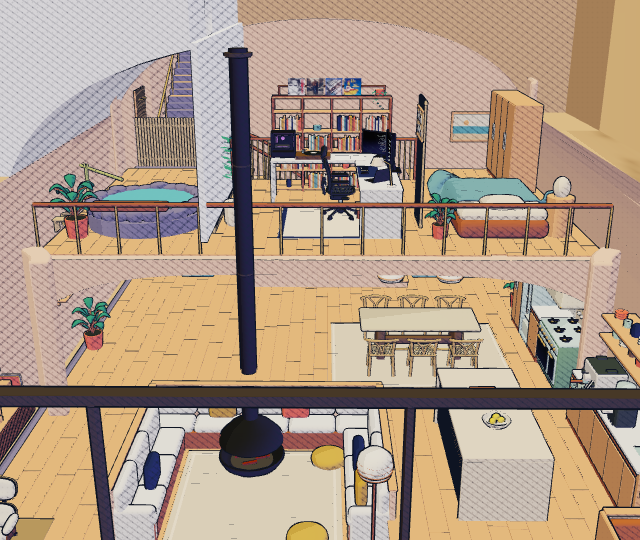
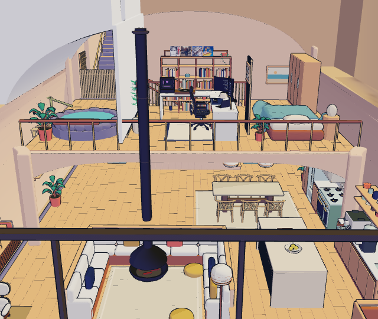

# Graphics studies runtime review — October 23, 2026

These are actual outputs of the production-built homepage's authoring controls, not mockups or source-only assertions. The active home retains its Realistic treatment. The JSON preserves the served module hashes, renderer, view, assertions and raw measurements.

The captured view is the whole home at 16:00 on October 23, 2026, in a 1440 × 1000 desktop viewport at DPR 1. The explicit lab camera targets `[0, 2.6, 0.6]`, yaw `3.15`, pitch `0.35`, radius `12`. Chromium 145.0.7632.6 rendered through ANGLE/D3D11 on Intel Arc integrated graphics. Other desktop UI checks were running on the same laptop; these are local observations, not an isolated GPU benchmark.

## Frozen photograph

[The eight-sample photograph](frozen-photo.png) is the actual output of **Graphics studies → Take an 8-sample photo** at 544 × 460 pixels. It took 2,649 ms in the recorded run. [The canvas before sampling](realistic-before.png) is retained for context; it includes the homepage's feathered CSS edge, while the returned image contains the canvas output itself. Their different capture paths and dimensions are not a pixel-matched quality benchmark. No improvement claim follows from this pair.

The photograph is nonblank, retains the same camera, and returns with Realistic still active. A live civil clock and an unpaused moving preview both reject the operation. Changing the preview minute during sampling rejects and discards it. The operation averages composed sRGB output after decoding it to linear light; it does not replace the renderer's antialiasing or implement moving-frame TAA.

The first cancellation pass found that a pending camera command could escape the signature while the canvas was offscreen: the requested orbit had changed, but its next composed camera had not. The coordinator added the requested camera state to the signature. The final regression **passes**: the command fired during sampling, the canvas was offscreen, and the operation rejected while the actual composed camera was still unchanged. The served fixed controller's SHA-256 is `715a7ac4523de16c8915b1a1e0b6d6eb18cac0edd5edc4e314d099be87567461`.

The original images and timing run retain their earlier build-3 controller hash in `sourceAssets`. The cancellation continuation has its own hash and observations in `cameraIntentRegression`; no new still-photo or ink module was substituted. Its two repeated ink captures were functional checks at a different model-streaming stage, not another sample of the timing comparison below. The native infinity water was also present with `castShadow: false` in that regression.

## Separate static-house ink comparison

| Screen-space baseline                                                                                        | World-anchored candidate                                                                          |
| ------------------------------------------------------------------------------------------------------------ | ------------------------------------------------------------------------------------------------- |
|  |  |

Both images came from **Compare ink studies** at the same camera and sun, at 640 × 540 pixels. Each contained 448 visible opaque static meshes, 508 draws and 1,301,196 triangles. Characters, transparent materials, water and the active home's postprocessing are intentionally excluded from this comparison.

After program warmup, five synchronized `render` plus `gl.finish` samples measured:

| Treatment        | Samples, ms        | Median, ms |
| ---------------- | ------------------ | ---------- |
| Screen-space ink | 13, 11, 15, 14, 21 | 14         |
| Surface ink      | 27, 19, 15, 18, 15 | 18         |

These are end-to-end synchronized draw timings, not GPU timer-query measurements. The candidate visibly removes much of the screen-wide hatch texture in this view. This single view establishes a working, different comparison; it does not establish better readability, movement coherence or speed.

Native WebGL instrumentation observed **zero `createFramebuffer` calls in each study context**. Each context did create 14 internal/procedural textures; “zero added assets” means no new downloaded model or image assets, not zero GPU allocations or JavaScript bytes. Both study contexts were lost after disposal. The active home's camera, 496 geometries and 65 textures were unchanged across the two studies. [The Realistic canvas after disposal](realistic-after-ink.png) remains nonblank, and [the actual controls and returned images](graphics-studies-ui.png) are retained. The final regression also exercised the real Zoom in control after two more disposed study renders: the camera moved, the frame count advanced, and [the resulting pixels changed](realistic-post-study-zoom.png). No console or page errors occurred. One aborted analytics request is retained separately in the JSON and did not affect the local scene.

This is an original analytic-hatching comparison informed by [Praun and colleagues' real-time hatching](https://hhoppe.com/proj/hatching/). It does not reproduce tonal art maps, lapped textures, curvature-aligned strokes or a learned representation. The [source review](../../../../docs/graphics-representation-review-2026-10.md) keeps those distinctions and future fit decisions together.

## Reproduce

1. Build and serve the current site. Open `/?scene-lab=1&weather=clear`, select 3D, and wait for all six rooms to load.
2. Open Explore, choose preview minute `960`, and visit Whole home. In the browser console, call `document.querySelector('[data-home-desk-scene]').setLabCamera({target:[0,2.6,0.6],yaw:3.15,pitch:0.35,radius:12})`. Keep the canvas in view until its requested frame has composed.
3. Pause motion, or enable reduced motion. Open Graphics studies and take the photograph. `labScene.captureStillPhoto(8)` exposes the same operation; its returned object contains the canvas and measurements.
4. For cancellation, begin `labScene.captureStillPhoto(16)`, then change the preview minute or request another lab camera **during** sampling. A command scheduled before the lazy module import finishes changes the initial view and is not a cancellation test. The retained probe scheduled its mutation after 50 ms and recorded that it fired.
5. Select Compare ink studies. The UI returns both images and writes their measurements to `labScene.lastStudy`; `labScene.captureInkStudy(false)` and `(true)` expose the same captures separately.
6. Confirm the active scene remains Realistic and usable, inspect the actual images, and record browser/renderer, viewport, camera, warmup and raw costs before making a comparative claim.

Implementation entry points are [still-photo.mjs](../../../../assets/js/home-scene/still-photo.mjs), [ink-study.mjs](../../../../assets/js/home-scene/ink-study.mjs), and the authoring adapters in [controller.mjs](../../../../assets/js/home-scene/controller.mjs).
