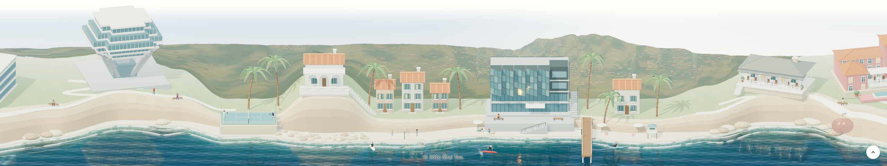
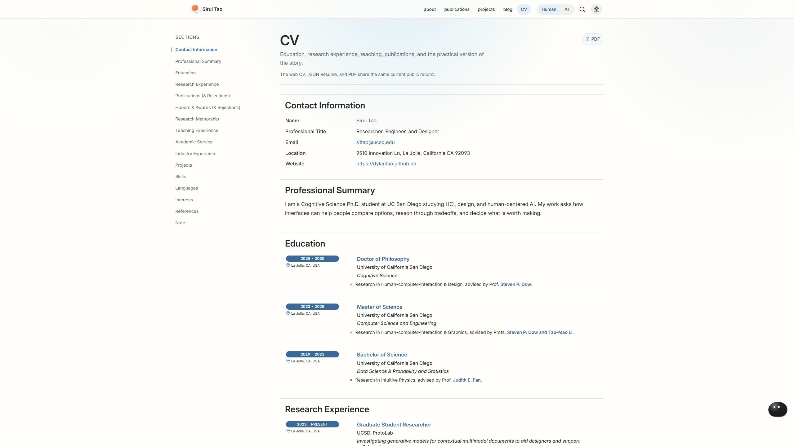
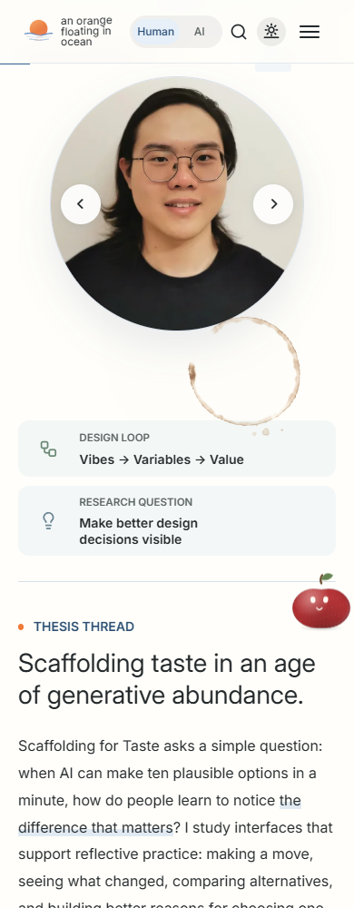

# Gym publication and page review, November 2

The directed [gym-lighting repair](../gym-ambience-2026-11-02/README.md) is published as `273063754`. All 46 visual jobs, integration, upgrade, formatting, security, deployment and deployed-link checks succeed. The source-link workflow is intentionally skipped for this scope. Eleven exact public response bodies match Pages `7d7546e9e`; the compiled inventory binds all 189 current source modules. The native home master, all GLBs and the disabled breakfast venue retain their previous state. The pavilion recipe checkpoint is the separate parent `330f220ce`.

A current production review captures twenty views at native 2560×1440 and a 390×1000 phone-sized Chromium layout. The initial name is Sirui, the desktop hover and touch button leave the orange/ocean story, the daytime coast is bright, the miniature remains visible, the coffee deposit is light, and the CV rail stays open and spaced. The evening footer and phone disclosure are retained alongside their daytime views. The coordinator inspected the saved images; this is not Sirui's taste approval, a physical-phone visit or a performance result. The complete four-width release checks belong to the green CI run above.

The review has no console or request failures and no horizontal overflow. Its strict stylesheet-body observer remains a retained failure: Chromium omits exactly the leading three-byte UTF-8 BOM from two stylesheet bodies. Independent HTTP readback returns the exact production files; all eight affected observations equal those files after that BOM alone. The separate qualification supplies that wire/source binding, while all 478 other observed bodies match directly. The earlier first-name getter also remains a failed control: it read the first animated letter rather than the complete word. Neither correction changes product code or the captured views.

These receipts finish the gym checkpoint. The new cliff silhouette, broad entrance, garden nook, breakfast entry/carry and final complete-world walkthrough remain under their own native and runtime gates; this packet does not admit those candidates.
