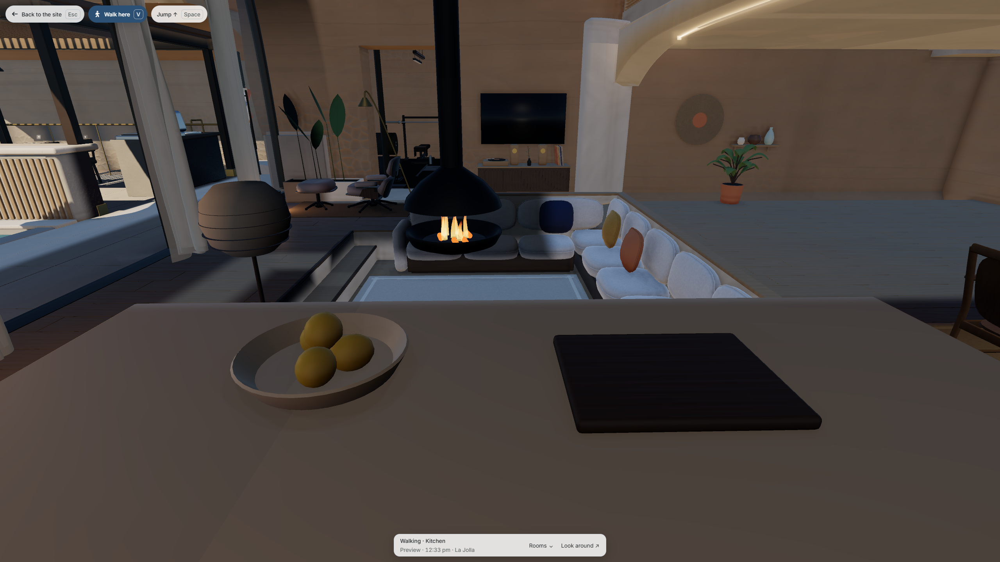
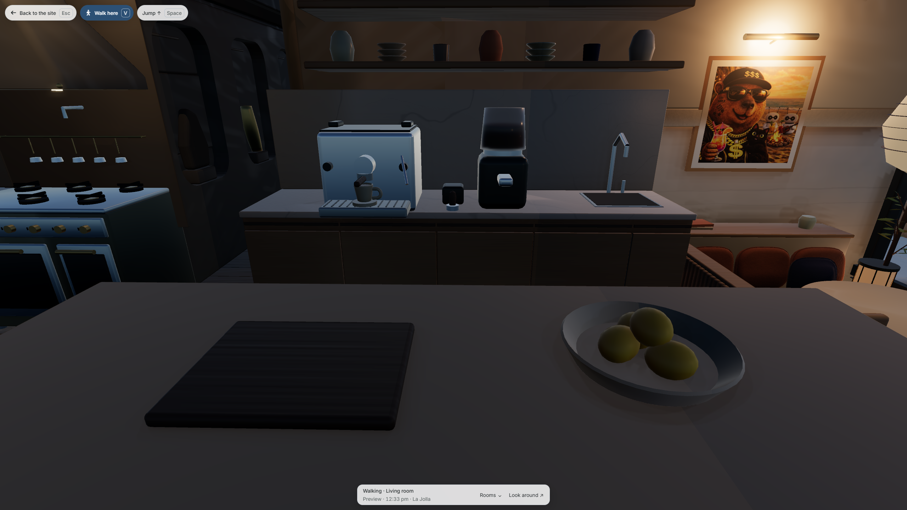
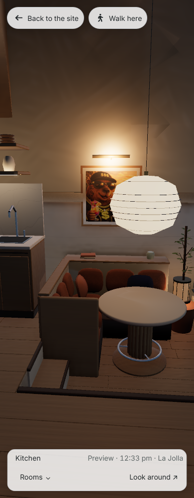

# A wider aisle around the kitchen island

The island loses 15 cm from its cooking side while its living-side edge stays fixed. The top is now 1.02 m wide by 2.51 m long. The chopping board, bowl and four lemons move together by 7.5 cm; the cooking, coffee and seated-meal anchors stay in place. Moving the entire island was rejected because it squeezed the opposite passage.

This delivery installs native master `cb531e3839358ec96b3da21ea09c3b2b69891e507bcf12d220b9a5e35e503fff` and kitchen export `6f8ef82b59c58a8a296d5fb795993e8ad599fba51764c56cd82934a8fe1e0697`. The [source review](../kitchen-island-2026-11-03/README.md) retains the original guards and rejected translations. The coordinator independently replays that source, verifies all 465 saved mesh digests against the worker's final replay and runs the unchanged owning 24-sample contact/indirect baker. Only the remapped corners of six named island receivers receive the bake. Other meshes, east flutes, floor fields, materials, roles and activity anchors remain exact.

The board and bowl become two separately named drawable nodes. All 83 original island parts and 16,372 native triangles remain; the bowl's 156 genuine zero triangles are preserved. The first decoded inspection incorrectly required every native triangle to have positive area and fails on those original charts. Its corrected inspection records both old and new zero counts, requires no new decoded zeros and never removes geometry. Actual delivered dimensions agree within 0.3 mm; bidirectional vertex-to-surface distances stay below 0.413 mm. Those samples are not a continuous Hausdorff certificate. Eighty-one real decoded-floor contacts remain within 2.62 mm.

The official runtime bake records 731,761 triangles before its region filter, 712,173 cache bytes, 16 regions, 128 probes and 28 practical sources. The fixed 750,000-triangle and 800,000-byte ceilings remain unchanged. All other model binaries are byte-exact. Perch geometry is unchanged after canonical triangle ordering; the producer updates its native-source binding. All loading views are traced again by the existing three-pass producer; only the index, kitchen and sleep drawing files differ.

The unmodified full overlap audits include the delivered furniture:

| Gate                 |    Native | Decoded delivery |
| -------------------- | --------: | ---------------: |
| Visible z-fighting   | 0.7686 m² |        1.0794 m² |
| Grazing seam         |   3.621 m |          4.226 m |
| Deep sites over 5 cm |       306 |              157 |
| Deep severity        |  37,938.9 |         25,584.2 |

An actual 11.33 m walk uses the public Kitchen arrival, ordinary keyboard steering through both aisles and the return to the same spawn. No Lab placement, changed capsule, door override or later teleport supplies the route. Functional time is controlled at a disclosed 10 Hz; this is not a frame-rate result. The original straight crossing clips the banquette and remains a failed control. A second complete loop fails only its estimated distance assertion because it stops short of the original spawn. The final route adds that missing return and keeps the original distance gate.

The complete source-bound product is inspected at native 2560×1440 and 3840×2160, plus 390×1000 modern PC WebKit. Public theme, Rooms and fullscreen controls work with exact observed scene response bodies and no console or request errors. A fresh complete production build also receives the four standard Chromium widths. The drawings' first preparation attempt omits the production baseurl directory and fails before launching a browser; its corrected run changes only that private output path. Original controls are retained with the final receipts.

The production build, 420 Python tests, 1,013 Node passes with seven existing skips, style contract and unchanged 150-case scene roster pass. The receipt distinguishes these local gates from later CI and live publication. The two extra drawable prop nodes have no isolated performance improvement claim. These captures are not physical-iPhone performance or Sirui's taste approval. The breakfast venue stays disabled; its full-body carry/entry and the new cliff, arrival and plant-garden integration remain separate work.
