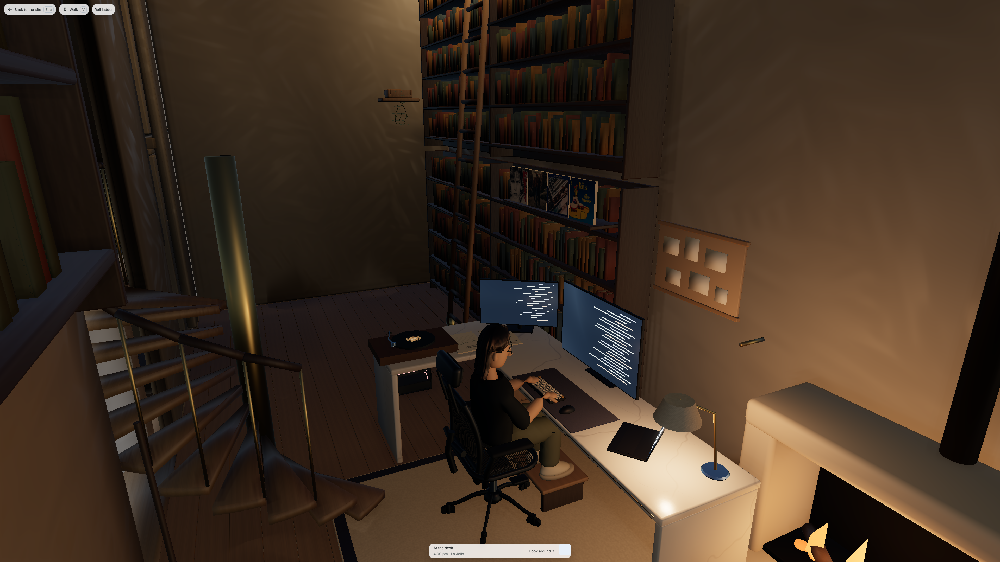
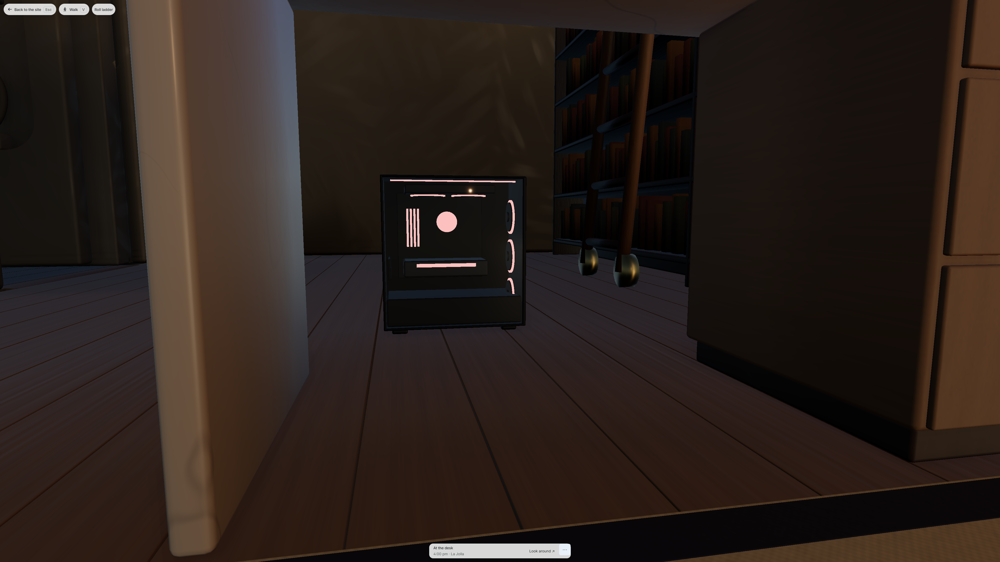
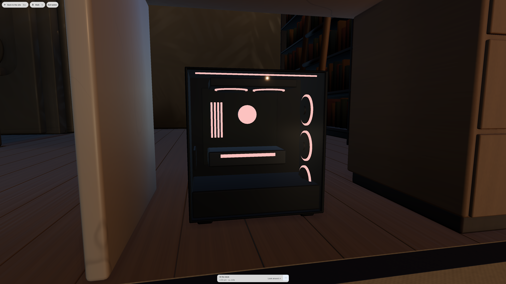

# Study hardware correction, October 29

The retained tower now fits entirely under the desk return. The active screen glass measures 43, 34 and 17 inches, following Sirui's explicit request. The secondary size remains 34 inches pending his answer to the separate hardware question; this does not assert a particular manufacturer's model or aspect ratio. The existing panel aspects, angles and laptop opening angle are retained.

This is a verified **native recipe and private exported candidate**, not a published scene or final lighting checkpoint. The coordinator must replay the recipe onto the accepted native source, bake the changed study, export it, rebuild dependent light/support/loading products and qualify the combined scene. The complete local preview deliberately retains the coordinator's previous official light cache; its restored state is recorded, not claimed to match the new hardware inputs.

## Visible result

The matched 4K public study captures preserve the Ghibli typing pose, keyboard, chair, footrest, records and camera. The lower inspection camera shows the same complete tower before and after its move; it is a geometry inspection, not a visitor eye-height claim.

| Original delivered study                                                | Candidate                                                                 |
| ----------------------------------------------------------------------- | ------------------------------------------------------------------------- |
|  |  |
|                |         |

Native Chromium also rendered the whole canvas at 2560 by 1440 on the actual RTX 3080 Ti/D3D11 renderer. The 4K buffer is 3840 by 2160, high quality, fixed resolution, with all ten base rooms ready. The four standard responsive widths and a separate WebKit 27.2 touch activation render retain nonblank study pixels and no runtime errors. These are appearance and input observations; they establish no frame-rate improvement or physical-iPhone acceptance.

## What changed

`bin/refresh_coastal_study_hardware.py` changes 4,584 vertices in 107 complete authored islands. It neither rebuilds the historical office nor transforms whole material batches containing the keyboard and mouse.

| Assembly                       | Original active diagonal | Candidate active diagonal | Complete assembly transform                                       |
| ------------------------------ | ------------------------ | ------------------------- | ----------------------------------------------------------------- |
| Primary                        | 44.1914 in               | 43.000008 in              | Uniform scale 0.97303966 about its desk support; native +0.12 m X |
| Secondary                      | 32.3895 in               | 34.000006 in              | Uniform scale 1.04972240 about its desk support                   |
| Laptop                         | 16.0843 in               | 17.000002 in              | Uniform scale 1.05693052 about its base support                   |
| Tower, internals and four feet | Unchanged size           | Unchanged size            | Native +0.86 m Y, equivalent to world -0.86 m Z                   |

The tower occupies native X -10.9324 to -10.4700, Y -6.1550 to -5.9250 and Z 0 to 0.506 m. The retained marble underside is at 0.830 m, leaving 0.324 m above the case. The main monitor's old foot overhung the desk's back edge by about 7 cm; moving the whole assembly inward makes its complete support footprint fit on the slab.

After reopening the saved candidate, raycasts to the actual oak and marble support every sampled bottom corner: sixteen tower-foot corners, four corners per monitor foot and four laptop-base corners. The maximum support discrepancy is 0.238 micrometers. The maximum individual vertex error against the intended complete-assembly transformations is 0.326 micrometers.

All unselected native mesh coordinates, topology, material assignments, UVs, baked-colour attributes and raw custom-normal fields hash exactly before, after and after reopening. Unselected effective corner normals have exact zero change. Thirty selected decoded normal vectors cross cells of the existing eight-bit normal encoder; that is separately reported below. No rig, hand, seat, foot, album, circulation, room architecture, flora, manifest or cache file was changed by this worker.

## Native and compressed-normal limits

The first private guard rejected a world/local float32 round trip at a provisional 0.0005-vector threshold. Local double-precision affine evaluation removed that unnecessary error, but a pure tower translation still changes the geometric reference frame used by Blender's retained short2 normal field. The second provisional guard also rejected that case. Both sources and logs are retained.

The reviewed selected-only native limit is 0.05 degrees, while unselected corners remain exact zero. The saved candidate's worst selected change is **0.029374 degrees**. Raw normal attributes and their storage remain exact; no shared attribute was converted or re-encoded.

The actual browser/Draco decode is a separate measurement. Its 25 meshes, 22 materials, 17,958 vertices, 29,152 triangles, every index buffer and every non-position/non-normal attribute match the delivered control. Unselected decoded normals are exact. Thirty selected decoded vectors change, with a maximum of **1.04520 degrees**; small native changes crossing the existing eight-bit quantizer cells are the inferred cause. This number is not relabeled as the native 0.05-degree result. The actual export was inspected at 4K.

Paired decoded positions follow the authored transformations within **0.220 mm**, inside the recorded paired position-quantization bounds. The decoded active diagonals are 42.9988, 34.0031 and 17.0055 inches. The existing position14/normal8/color6 quantization is unchanged.

An unchanged-source effort10 control reproduces the original **70,976-byte Draco BIN chunk exactly**. Its JSON differs only in later scene-level migration metadata. The final effort10 candidate is **112,852 bytes**, SHA-256 `16295563bff0783f8544e2be6df7dfce1d6d53ae38122fc9effcca917b84e913`: 416 bytes above the delivered file, 288 above the same-source effort10 control. The exploratory default-effort7 export was larger; both efforts decode to exactly identical arrays, and the final 4K pixels match the retained effort7 render exactly. This is a custody/compression control, not a speed claim.

## Gates and custody

- Exact Blender 4.5.9, with `--python-exit-code 1`; candidate input SHA-256 `75afc57f664101e59150910f86662b21ccf01087c393521ab1fa1886e481c5ad`.
- Strict island/count/position fingerprints; a same-count 100-micrometer input perturbation fails before migration, and a second application is rejected after reopening.
- Complete frozen coordinator production build copied and hashed: 1,360 files. Exactly one preview file changes, `assets/models/home/room-study.glb`; all 121 home HTTP bodies match the retained local bytes. The supplied runtime/manifest include coordinator changes beyond this worker's branch; their actual compiled bytes are bound separately.
- Native 4K and 2K full-buffer captures, all four standard widths, and WebKit 27.2 touch activation. Joint coordinates, actor placement, typing animation and interactive record targets match the paired original exactly.
- Existing `visitor circulation: the study joins outdoor living and the living facade returns to the same floor` passes against the final effort10 preview. Its documented initial study fixture is followed only by ordinary keyboard input through the usable covered patio and return, plus living-to-patio and return; the test forbids later placement overrides. Its progress and screenshots are retained.
- 319 Python tests, style contract, Python compilation and `git diff --check` pass. An initial PowerShell stderr wrapper reported failure despite unittest `OK`; the retained subprocess receipt records the real repeat return code 0.

The recipe is source commit `e773eb0d1`. It defaults to a private candidate and refuses to overwrite its input or the canonical master. `migrate(scene)` supports coordinator replay on an accepted F6 source when the retained hardware fingerprints still match. Do not run an old complete office rebuild, merge `.blend` binaries, or reuse the old light cache for publication.

The private native candidate and complete preview remain under `.jekyll-cache/visual-qa/study-hardware-20261029/` in the owned worktree; preview port 4154. This review packet seals portable receipts, relevant producers, both GLBs and actual screenshots. Large private native/compiled copies and exploratory camera frames remain in QA. No independent push was performed.
