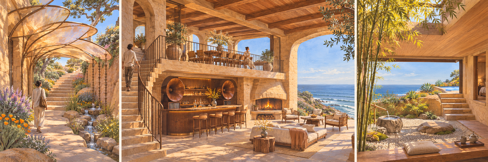
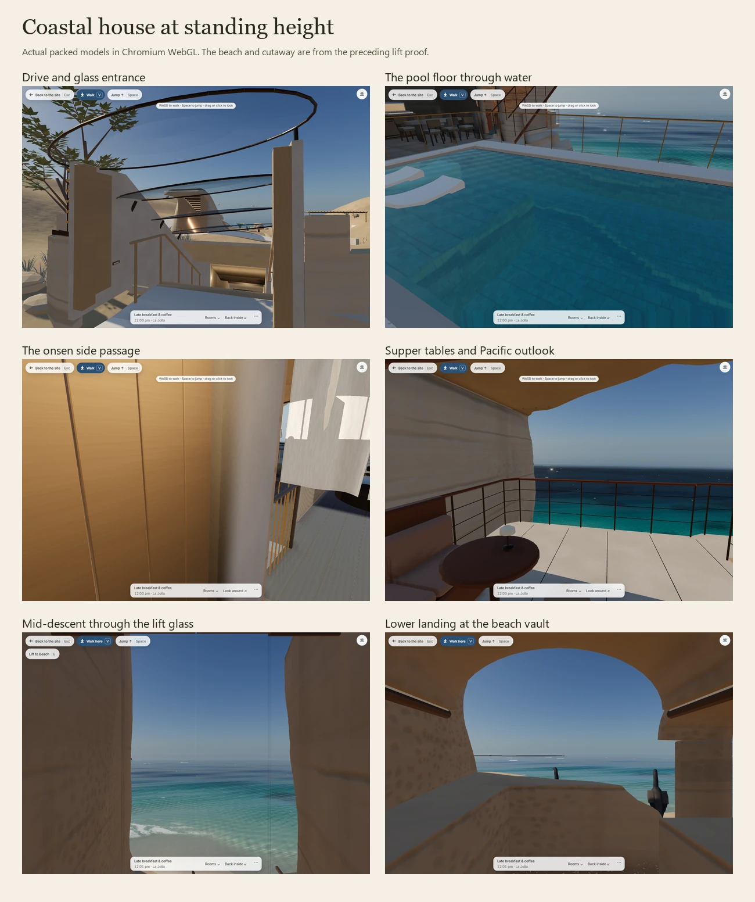
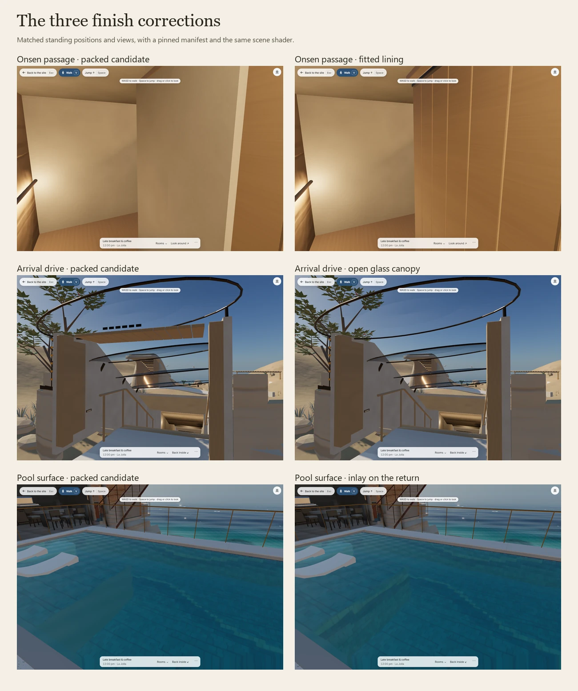
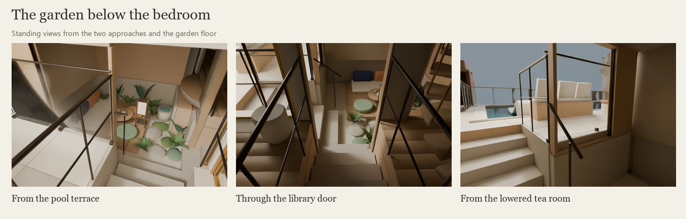
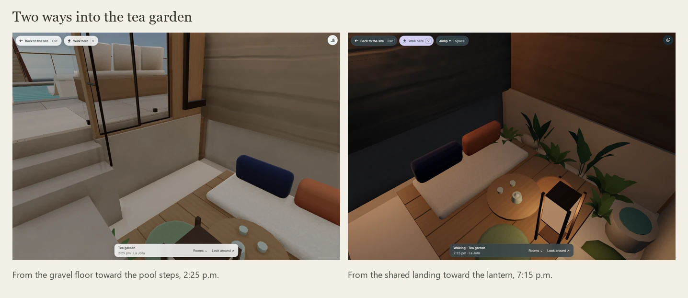
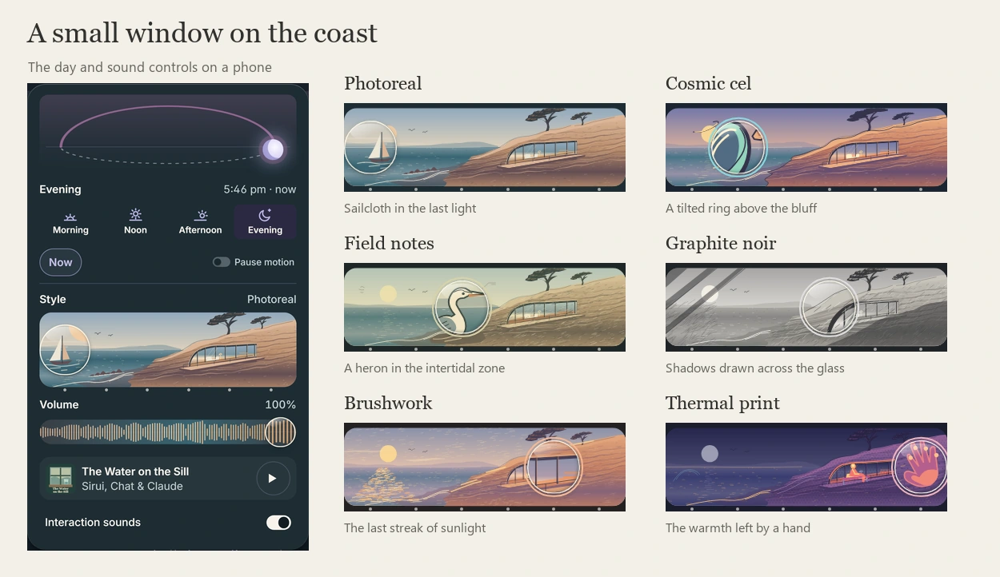
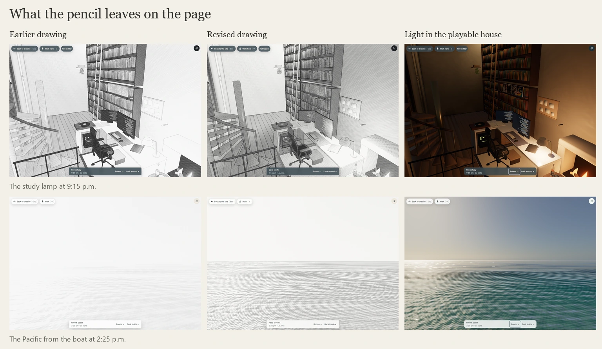

# Three passages through the cliff

Sirui’s November 21 walking screenshots put the work at three thresholds. The sketch follows a guest from the entry to the listening terrace and the garden beneath the bedroom. The glass overlaps toward a drain, a stair connects the two social floors, and the garden window opens into a wall pocket.

## Walking the house

At the onsen side entrance an old stone edge used to hide the oak. The new face sits 103 mm forward. A second walk from the driveway distinguished two defects above the stair. Twelve oak slats belonged to the retired lid, while six black marks were light markers placed by the browser. The pool's nine exposed riser faces now carry the same tide of ceramic as the submerged benches. The drawing still gives the glass leaves a brighter edge in sunlight and the supper terrace a deeper foreground shadow.

The second garden fitting in Blender. Both leaves are in their wall pocket. The paper lantern stands beside the low table and the fixed upper guard still protects the pool terrace. Cycles uses an afternoon preview sky and a clear-glass treatment corresponding to the browser’s glazing. Walking these two approaches in the assembled house also exposed where the stair heads met the older level promenade.

The final two flights share a landing. Both lead out of the lowered garden while the upper patio remains level all the way from the study to the barbecue. The new arrival faces the tea service and pool steps. From the landing a visitor can turn to see the lamp, gravel and water basin together. These frames are the starting views for the new planting and light study.

## The style and sound panel

The first small panorama made the styles read as swatches. These six original SVG drawings share the bluff and the horizon so the visitor can follow the coast through a change of medium. The lens enlarges the actual paths at the screen’s pixel density. The waveform below follows the selected score. [Source drawings](../../../../assets/js/coastal-control-art.mjs) · [The recordings and gesture sounds](../../../../docs/house/world-music.md)

## Graphite in the playable house

The study camera stays at the room arrival at 9:15 p.m. For the seaward view, the guest takes over from the boat at 2:25 p.m. and turns toward open water. The new drawing leaves the paper brightest where the real lamp reaches the tabletop. Through the boat’s horizon the lighter side of a crest erases a small piece of lead. [Drawing rules and measurements](../../../../docs/worlds/pencil.md#the-boat-and-the-reading-lamp-november-21)

## Architectural study

Built-in ImageGen, November 21, 2026. Original concept commissioned for this site. The study supplies spatial and material direction. The playable rooms have measured dimensions and retain the house’s existing sandstone, pool and working stair.

**Prompt**

> Architectural concept board for the renovation of Sirui's playable La Jolla sandstone cliff house. A single wide landscape triptych, three eye-level architectural gouache and fine graphite perspectives. First: a visitor reaches a hillside stair in a native California garden. Floating overlapping, pitched, translucent warm glass petals between slender bronze ribs span the entrance like a kinetic sculpture; thin rain chains descend at the low edge into a stone rill and planted infiltration bed. The terrain actually opens for daylight grazing the upper stair. Second, dominant panel: look obliquely across a two-storey seaside loggia. Retain an intimate sandstone listening bar with oversized polished walnut horn speakers below, a protected outdoor hearth beside it, and an open gallery dining alcove above, a visibly walkable narrow stair climbing beside the bar so a guest can see where it leads, dark bronze railing, Pacific blue through a generous open end. Human-scale furniture. Third: intimate sunken Japanese pebble garden and low seat directly below a bedroom, sunlight on fine bamboo and honey timber, a wide calmly framed horizontal Pacific view with a bronze pocket for fully retractable glazing, small recessed doorway and a few stone stairs leading UP to the pool deck. Cool marine sky and golden sun; estate grounded in unbroken honey sandstone. Daily inhabitation, warm, clear spatial logic, no lettering, no labels, no green glass color cast, no dark atmosphere. Render as three beautiful believable drawings that a game-world builder could translate into walkable architecture.
