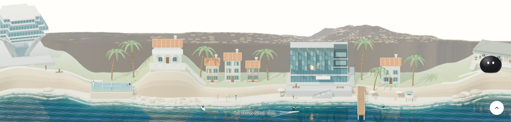
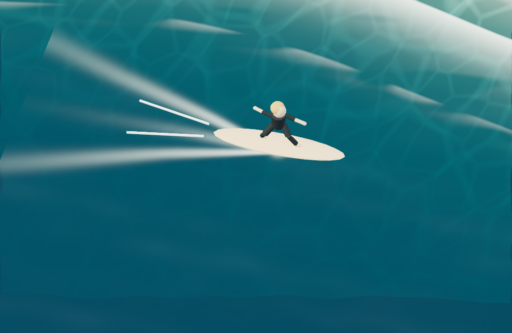
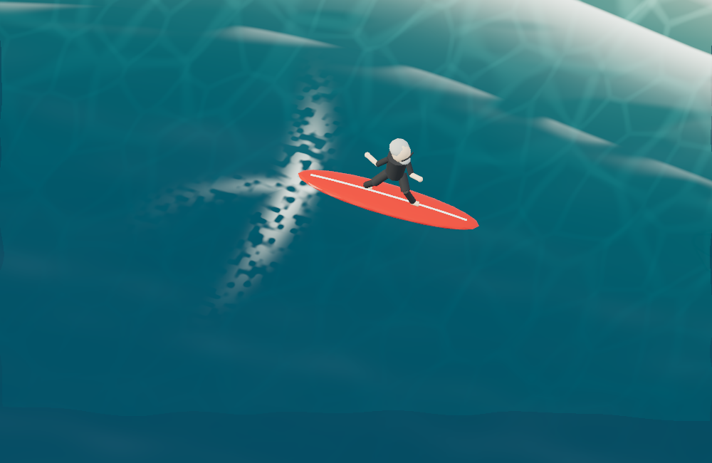

# Jim Hollan rider and wave, October 28, 2026

The original rider slid backward while still facing forward. Two white wake meshes moved rigidly with the board, over a second shader wake. The replacement follows a slow 31.416-second closed carve: its nose follows analytic velocity, its board frame follows world water slopes and turn banking, and its small crouch follows the same speed/turn state. Feet stay planted and the existing two-bone solver keeps limb lengths. Pausing now holds the current body and board together instead of resetting the body to time zero.

The red board has a thin original white mesh on its deck. Grey hair, glasses and a beard suggest Jim Hollan at close range; black clothing and the board are Sirui's art direction. The [official portrait](https://cse.ucsd.edu/people/faculty-profiles/james-d-hollan) and [his UC San Diego site](https://hci.ucsd.edu/hollan/) were inspected. No portrait pixels or downloaded character mesh ship. The small figure is illustrative, not a portrait-quality reconstruction or a factual record of his surfing equipment. [The rendered public credit](cameo-excerpt.png) makes that distinction.

The wave is a separate localized shoulder with the same analytic height/slopes on CPU and GPU. Its broken lip and fading foam track follow the actual tail path. The two global ocean modes, seabed, refraction, caustics and reflection schedule remain unchanged. The waiting and paddling surfers retain their native geometry, materials and live paths. This is authored animation and shading, not a surf dynamics simulation.

## Actual renderer evidence

| Before                                                                    | Candidate                                                                  |
| ------------------------------------------------------------------------- | -------------------------------------------------------------------------- |
|  |  |
|                                   |                                    |

The first row is the real 1440-pixel public footer. The second is a **camera-only diagnostic** of the complete renderer at 1000×650, to inspect the small body and deck; it is not the public framing. No model, water pass or scene asset was omitted. [The retained camera script](close-review.cjs), [before binding](before-close.json), [after binding](after-close.json) and [production response hashes](production-binding.json) distinguish raw diagnostic source from the unmodified minified production graph. The production browser fetched the changed graph and both exported models; all recorded responses match the built bytes, with no page errors.

Both full-cycle cases passed against the production build, with nine measured states per viewport, five rendered cycle frames, reduced-motion holds, offscreen suspension/resume and initial reduced-motion stills. The actual board quaternion follows the reported heading. [Cycle summary](cycle-summary.json):

- Desktop: [start](desktop-1440/surfer-cycle-0.png), [quarter](desktop-1440/surfer-cycle-2.png), [half](desktop-1440/surfer-cycle-4.png), [three quarters](desktop-1440/surfer-cycle-6.png), [return](desktop-1440/surfer-cycle-8.png), [initial reduced motion](desktop-1440/surfer-reduced.png), [measured states](desktop-1440/cycle.json).
- Phone: [start](mobile-390/surfer-cycle-0.png), [quarter](mobile-390/surfer-cycle-2.png), [half](mobile-390/surfer-cycle-4.png), [three quarters](mobile-390/surfer-cycle-6.png), [return](mobile-390/surfer-cycle-8.png), [initial reduced motion](mobile-390/surfer-reduced.png), [measured states](mobile-390/cycle.json).
- Other standard widths: [1280×800](laptop-1280.png) and [768×1024](tablet-768.png). The scoped footer regression run passed 12 cases, with four intentional viewport skips: loading-still handoff, noon composition/credit, composed automation/live people, and reduced-motion/context recovery.

All twelve [runtime posters](../../../../assets/models/la-jolla/posters/) were regenerated by `bin/render_coast_posters.cjs` against the verified raw overlay. `version.txt` hashes the whole family; the poster unit test passes. New dated module/model queries and the built scene hash keep the graph and models together. These are functional Windows Chromium renders, not an isolated hardware benchmark or a physical-phone performance claim.

## Native and export custody

`bin/coastal_surfer.py` is shared by the full builder and the bounded saved-source repair. `bin/refine_la_jolla_surfer.py` patches only Surfer1's board material, adds the deck stringer and removes its rigid foam mesh in each existing `.blend`, then exports both GLBs. It never rebuilds the surrounding coast. The full builder includes the same treatment; the miniature builder inherits it from the full source.

[Native readback](native-readback.json) passed for 233 untouched footer objects, 41 untouched miniature objects and all 38 pre-existing materials in each source. The comparison covers exposed transforms, topology/vertices/attributes/material assignments, modifiers, custom properties, camera/light values and animation references. [Export readback](export-readback.json) compares every non-rider node with baseline `759a3b58b`: all 220 footer and 37 miniature nodes retain identical compressed geometry payloads, material definitions, accessor bounds/counts and transforms. [The comparator](compare_exports.py) reproduces that check. The manifest triangle count is 148,328 and matches the actual footer GLB.

The mandated Blender 4.5.9 build `8bf95cbd38d1` warned about source file subversion 4.5.92; the saved files report 4.5.91. This is recorded, not dismissed. The strict comparison excluded session IDs and memory addresses, and unused materials were explicitly retained with fake users so Blender would not drop them. The audit does not certify unknown newer-version fields that 4.5.9 cannot expose; unchanged non-rider exported payloads provide the separate rendered-geometry check.

## Checks and reproduction

- 28 focused Node tests passed: people, full-cycle ride derivatives/frames/contacts, native board exports, global waves, water and poster versioning.
- All 314 Python tests passed; targeted Prettier, style contract and `git diff --check` passed.
- Scene registry: 126 cases in each standard project, 30 in `scene-footer-light`, no missing/extra/duplicate cases.
- Complete production Jekyll build passed with `/al-folio`, including responsive-image generation; publication/AI-output validation passed. The first local build used Windows' unrelated `convert.exe`; the successful run used the existing `C:\tools\site-bin` ImageMagick wrapper. Failed attempts and full logs stay in ignored `.jekyll-cache/visual-qa/surfer-2026-10-28/`.

From the repository root with an owned complete preview:

```powershell
node --test test/coast-surfer-motion.test.mjs test/coast-surfer-native.test.mjs test/coast-people.test.mjs test/coast-wave-motion.test.mjs test/coast-water.test.mjs test/coast-posters.test.mjs
python artwork/la-jolla/reviews/surfer-2026-10-28/compare_exports.py
$env:NO_WEBSERVER='1'; $env:VISUAL_BASE_URL='http://127.0.0.1:4111/al-folio'
npx.cmd playwright test --config test/visual/footer-coast.config.js --project desktop-1440 --project mobile-390 --grep 'coastal surfer:' --workers 1
node artwork/la-jolla/reviews/surfer-2026-10-28/close-review.cjs
# Pass --baseline to the close-review script for the retained pre-change view.
```

This checkpoint is local and ready for coordinator integration. Publication and the combined release checks belong to the coordinator.
