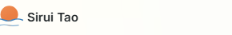
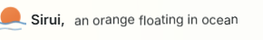
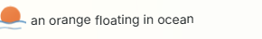

# An orange floating in ocean, October 28

Sirui rejected the heavy greenish K, the separate dot on blue lines and the monochrome reflection N. His latest direction restores two colors: a round orange slightly submerged behind blue waves, a tiny warm reflected highlight, a small size/buoyancy gesture and subtle variation with the site's day. This candidate implements that direction. Sirui's appearance acceptance remains open.

The mark and name at native size:

The foreground wave is the actual clipping boundary of the round orange. Its shared drawing/clip curve moves horizontally; the orange bobs by 1.05 drawing units and varies scale by 1.5% over 5.6 seconds. Blue remains blue. Only a small window of the two wave strokes carries a warm tint. Orange, water and glint colors inherit the existing page sky variables, and the glint position follows the existing sun arc. This is an authored gesture, not a buoyancy or optics solver.

The initial identity stays still. A moving fine pointer dwelling for 120 ms or keyboard focus starts discovery: Tao dissolves, the full phrase appears, then Sirui fades/drifts away while the phrase takes its place. Leaving does not rewind it. The native home link and refresh restore the serious name, including under a stationary pointer. Touch keeps the ordinary home action. The accessible home-link name remains Sirui Tao; the AI profile stays static. Reduced motion reveals the final phrase without animation. The global motion switch holds and resumes both mark and lettering. Hidden pages pause the CSS animations. No new render loop or dependency is added.

The name viewport reserves its width. Desktop keeps the phrase on one line; compact layouts use complete wrapped words and a shorter dissolve. Letters translate without scaling. The nearby navigation does not move. The SVG and native 16/32/48-pixel favicon entries share the geometry; [the icon family](native-icon-family.png) includes the home-screen icon.

## Rendered evidence

The [source/output receipt](review-inputs.json) binds the actual Liquid/Jekyll markup, Sass, script, icons and retained captures. The complete compiled UI preview at 4114 includes the site's assets. Its home model/cache family was restored together from verified 759a3b58b after a staging build exposed the unbaked v84 descriptor. No source cache or descriptor was hand-edited. New-house admission and its final canonical bake are separate from this UI proof.

- Chromium: 13 passed with 7 intentional scope skips in the complete brand suite;4 final discovery/global-pause cases passed across 1440/1280/768/390.
- WebKit phone emulation: 4 passed with 1 intentional scope skip; the final discovery/global-pause case passed separately.
- Home/blog checkpoint: 8 route cases passed at the four widths. The fixed-header text-shape regression passed 8 light/dark cases. Two Python brand checks, style contract and targeted formatting passed.
- The browser asserts the exact rendered Sirui/Tao name and rejects residual Liquid. The earlier iteration proxy's string substitution was replaced with the real Liquid renderer. Raw-proxy passes did not establish production correctness.
- Actual native-size orange pixels vary by more than 4% over a complete wave cycle, beyond the scale-only area change. Computed sky-dependent colors/glint positions differ across four stops. Full word bounds, unchanged navigation and unit letter scale are retained in the four motion receipts.
- The header override was reviewed and its acknowledgement updated. Unrelated baseline overrides were preserved.

[Morning](navbar-morning.png), [noon](navbar-noon.png), [afternoon](navbar-afternoon.png) and [evening](navbar-evening.png) retain the full navbar. The compact results are [1280](navbar-laptop-1280-adrift.png), [768](navbar-tablet-768-adrift.png) and [390](navbar-mobile-390-adrift.png). These are host browser checks, not physical-iPhone performance evidence.

## Retained rejection

[Monochrome N at rest](rejected-monochrome-rest.png), [its drift state](rejected-monochrome-adrift.png) and [its original SVG](rejected-monochrome.svg) retain the rejected direction. Its functional passes did not make the mark meaningful to Sirui. The earlier [I/J/K study](../abstract-sunset-2026-10-26/README.md) remains history too. The current contract is the Brand Mark section in `docs/material-lite-revamp.md`; neither old study is an approval to restore that appearance.
