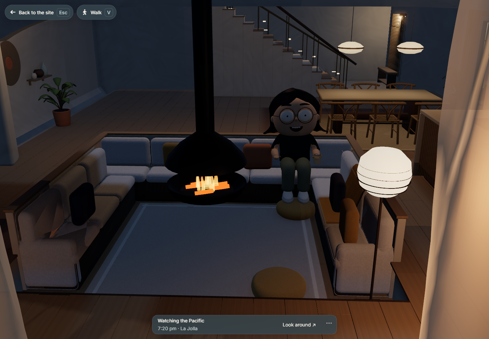
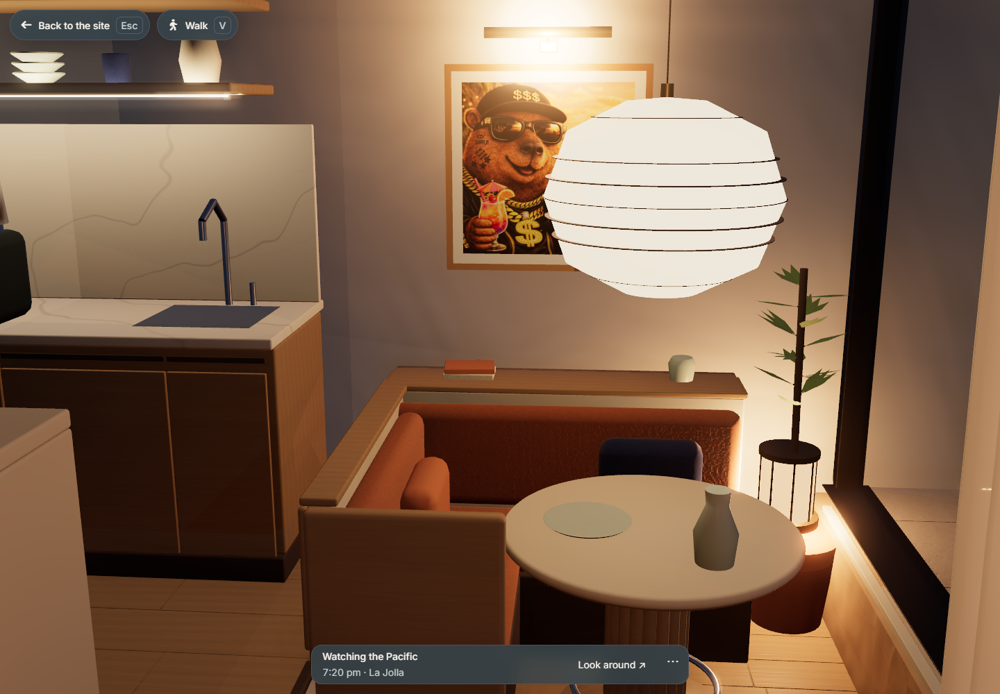
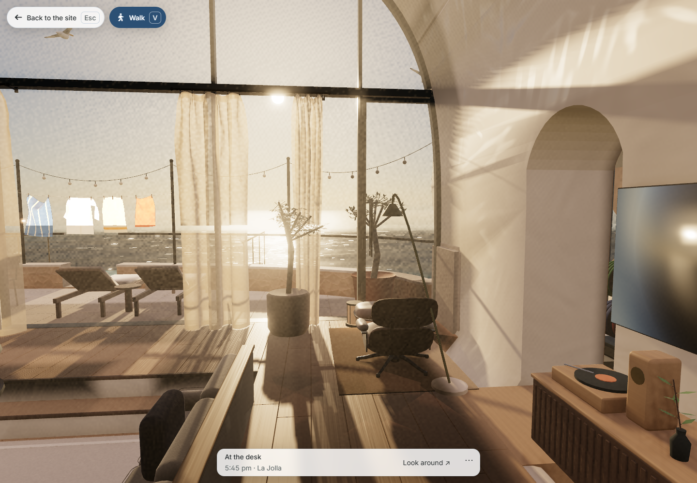

# Clifftop arrival, interior and loading

Sirui reported invisible walking barriers, an unusable exit, ambiguous stair edges, a public entrance into private quarters, mobile stalls and visible furnishing after the loading transition. This pass treats the route and the first complete view as the acceptance targets.

The public route now descends from the retained clifftop portal through 32 existing and 16 new treads to a lower foyer and living circulation. The upper gallery remains an optional side entrance. A real cedar obstruction was cut from the rear doorway; guards close the misleading edges. The lower cupboard banks are removed, with a recessed oak coat/shoe bench in the foyer. The sofa keeps the seated anchors and gains cushion welts, leaned pillows and one draped throw. Two actual dining pendants and bounded entrance washers drive the light metadata.

The native source survey checks 58 route points: floor agreement within 2.5 mm, minimum headroom 2.227 m. The delivered-GLB capsule test traverses the 29.54 m main route, 3.64 m private entrance and an 11.83 m clifftop loop in both directions using horizontal movement alone; the largest actual riser is 0.163 m. A separate 31.3 m rooftop crossing and return checks the roof's actual support, including when orbit cutaways hide it. This evidence uses decoded Draco triangles and the runtime collision solver, not surrogate boxes or injected walking heights. Editable-source geometry, exact four-asset hashes, and matched Blender lounge renders are retained in [the architecture record](../../../artwork/coastal-home/reviews/arrival-living/README.md). The four assets add 85,172 bytes and 18,418 triangles, without new textures or render passes.

Full-suite source checks caught an unrelated-geometry regression before release: a Boolean applied to a wholly disjoint material batch had silently dropped remote sandstone islands. The repair restores all 96 native connected components, including their material bindings, and skips disjoint targets. A deliberately intersecting cut preserves all 95 remote components exactly. Regenerated native perch data agrees at all four rock roosts within 0.35 mm. Repeated audit leaves the repaired source bytes unchanged; the final light field was then regenerated from that source. A manifold result alone was insufficient evidence of geometry preservation.

Movement now integrates velocity over time consistently at 24/30/60/120 Hz, clears held touch input on focus loss, waits for the first real collision snapshot and can recover a failed collision worker. Soft leaves and grass no longer form walls; rigid trunks remain solid. The first Walk activation starts at the main entrance, and a same-room orbit detour can resume the visitor's safe pose.

The opening sequence waits for all six interior base rooms, 17 default furniture placements, textures, the selected avatar, lighting, composed steam and shader variants. The five progress segments remain tied to finished work; the pen sketches were regenerated from the changed geometry. The 403,489-byte precomputed light field binds to exact assets and runtime sources, validates its response checksum and configuration, and falls back to tracing when unavailable. It preserves time-dependent sky and lamp powers. Unit tests check exact sample parity after restoration and reject stale configuration, invalid lengths, nonfinite values and finite overflow payloads.

The native phone-sized capture at 390×844/DPR 3/touch/seed 41 reached its complete first draw in 22.95 seconds with the cache, versus 33.37 seconds without it. Restoration took 1.3 ms with no visitor bake. No interior model requests started after readiness, no browser errors occurred, and reduced motion settled without further frames. Roughly 30 fps in the host's full-screen sample is an observation, not a physical-phone benchmark. The old baseline exposed an incomplete frame sooner; its subsequent stalls are not comparable to the new complete-view timing. A baseline full-screen capture stalled once and was stopped. Raw recordings, native CPU/GPU measurements and acceptance JSON live under `.jekyll-cache/house-performance/`; the final recording SHA-256 is `074b0e75f673fe6932de2e051095069d48ac0657e312692cb868018fedc509c9`.

The final night comparison exposed another existing obstruction: the kitchen camera stood 2.94 cm outside the curtain plane. Its authored arrival now stands inside the glazing, and an explicit room visit gathers that room's pair while Sirui is awake, so either side of a free orbit stays usable. Other rooms retain their sun/night drapes, and sleep still closes them. Paused and reduced-motion views compose or hold the drapes without stepping.

The browser acceptance checks passed at 1440×1000, 1280×800, 768×1024 and 390×1000. These cover the complete loading transition, sketch handoff, walking and orbit return; the phone case also checks both touch sticks and focus-loss release. A desktop keyboard journey follows the full entrance-to-living route and returns to the clifftop using actual W/arrow input. It does not inject floor heights. Walking keeps the enclosing roof visible, while orbit views retain the cutaway. Fifteen active targeted cases passed, with nine intentional viewport skips. The final curtain changes also have 22 passing cache/curtain unit checks.

All 271 Python tests passed; the Node suite reported 622 passes, seven existing skips and no failures across 629 tests before the final curtain adjustment. The four final curtain browser cases also passed across the same viewports, covering wind, pause and reduced motion. A Linux Docker root-site production build passed, including generated-publication validation; the production homepage checkpoint passed at all four viewports with light/dark, focus, motion and overflow checks. Windows lacked the image tools for a fresh destination, so that attempt was stopped and the actual production proof uses Docker. Raw logs and browser evidence remain under `.jekyll-cache/house-review/`.

Checking built bytes caught a release-only cache miss: Jekyll's JSON minifier stripped the final newline, invalidating the response digest. The cache now has an explicit minifier exclusion. The production-output validator checks its exact SHA-256 and source signature; four regression cases include the newline-stripping failure. Other generated JSON may still be minified normally. A valid source cache alone is not evidence that the visitor can restore it.

The final Docker production build passed the byte check. A fresh native phone-sized visit to that output restored the cache in 0.6 ms with zero visitor bake, six rooms and 17 default furniture placements at first reveal. No model loads began afterward, no runtime errors occurred, and reduced motion held at 58 frames over the final 1.2-second observation. The live-clock night lounge was inspected directly. Its raw receipt is `.jekyll-cache/house-performance/production-phone-first-ready.json`, SHA-256 `54106381c247be31ad3bc50612724484ae18bf944faf209c979365021cfb949c`.

The retained phone timing above is a candidate measurement before the final shoreline-preservation repair and kitchen framing adjustment. It supports the removal of the visitor bake, rather than a precise final-release timing promise. Physical iPhone/Android thermal and sustained walking performance remain a device check; this change does not claim photographic realism or a measured mobile FPS increase.

