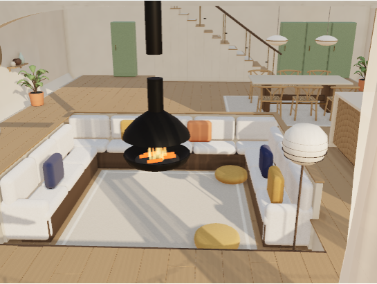
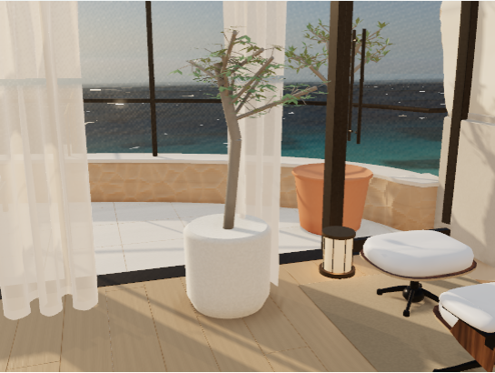
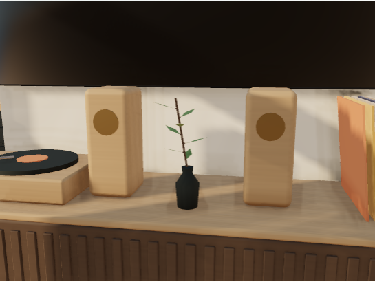

# Retained living plants — October 23, 2026

The living-room furniture rebuild removed the original `lounge__olive leaf` and supporting wood batches: 176 olive groups and seven small plant groups. This restores their original site-authored geometry from `512fc0807` in a six-part native library. Future living-room rebuilds retain or reload those parts once. The library contains no former floor or furniture.

The olive stands outside the sunken pit and clear of the Eames footprint. Its pot sits on the actual finished floor at Blender z = −0.0195. The small plant sits on the credenza's oak cap at z = 0.584, in the gap between the speakers and clear of the record sleeves. The 256 existing native objects, their geometry, world transforms, material slots, and baked colors match the pre-fix source exactly. All other GLBs and the manifest, including its 17 furniture anchors, retain their original bytes.







The appended [native and browser acceptance record](../../../artwork/coastal-home/reviews/living-plant-restoration.json) binds these PNGs to the actual exported lounge hash. Chromium at 1440 × 1000, DPR 1, loaded all six rooms and measured 403 rooted groups and 30 intentionally unsupported study groups. The main and olive views held identical reduced-motion pixels and changed pixels when motion resumed. Earlier credenza checks showed held-frame residuals: 155 pixels changed by at most 2/255, then 222,354 pixels by at most 65/255. The final settled detail capture held identical pixels and changed pixels when motion resumed; this does not erase the earlier residual. Its [earlier first frame](credenza-residual-before.png) and [held frame](credenza-residual-after.png) remain available. The shared pause/recovery integration test remains authoritative. There were no browser errors in the final captures. Timing samples are local diagnostics, with a concurrent CPU-only native audit, and are not a GPU performance comparison. Previous interior acceptance records remain unchanged.

Reproduce the bounded browser check from this worktree against the root production build:

```powershell
$env:ENVIRONMENT_EVIDENCE_DIR='.jekyll-cache/visual-qa/living-plants'
node bin/verify_environment.cjs lounge,lounge-plants,lounge-table
```

For the read-only native preservation, support-ray and idempotent reload check, extract `artwork/coastal-home/coastal-home.blend` from `49d99b07716f46771afcbd782674d63b9bc75360` into an ignored cache file, then run:

```powershell
blender -b -t 6 --python-exit-code 1 --python bin/verify_living_plants.py -- --baseline=.jekyll-cache/pre-restore-coastal-home.blend
```

The retained library and house are editable Blender sources. Their provenance remains the site's original authored geometry; this restoration introduces no third-party asset or license.
