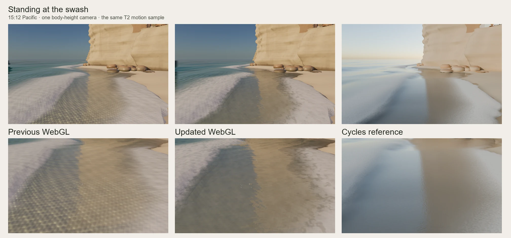

# The beach at 15:12

In the playable frame a dark strip followed the edge of the screen as the visitor turned. A matched replay traced it to the reflected camera ending inside the visible sea. The mirror now covers an extra 18% of width and height at the same texture size. The edge measured 101% of the luminance of adjacent water, up from 14%. The central reflection still carries the fine detail of the cliff. [Matched browser frames and enlarged water details](../../../artwork/concepts/coastal-home/2026-11-19/shore-reflection-before-and-after-17.webp).

The standing view looks along the sedimentary cliff and shallow Pacific at La Jolla. It uses a 1.60 m eye height at a verified dry Walk position and a 44° vertical lens. [Camera, render settings, and measured selection](preset.json).



The top row uses the full frame. The bottom row crops the same near-water region. Exposure is aligned in linear light using a foreground sandstone rectangle. The captured T2 grid supplies actual surface height, foam, runoff moisture and seabed values. Cycles traces a closed water volume from those samples. Its dielectric, foam, sediment optics, sub-pixel ripple material and clear sky are local material approximations. The sea beyond the sampled coast closes as a 6 km flat extension.

The final comparison’s thin-film window has a measured median depth of 181 mm. Normalized fine-pattern variation reads 0.1074 in the previous WebGL, 0.0299 in the updated WebGL and 0.0127 in the Cycles reference. The open-water window shifts by 0.0026 in mean absolute linear luminance. The camera angle and physical wave sample match. The Cycles lighting and separate material closure produce a brighter near-water film.

## Repeat locally

Start the local site you want to measure. Capture from the repo root with Node and the installed Playwright browser. Give each capture a fresh ignored output directory. The tool uses the private scene lab camera and fixed surf clock. It retains the ordinary fauna frame and a comparison frame with fauna parked outside the view.

```powershell
node bin/capture_coastal_shore_study.cjs --url=http://127.0.0.1:8080/ --out=.jekyll-cache/visual-qa/shore-study/webgl
```

The capture writes `webgl-receipt.json`, the little-endian Float32 `water-grid.f32`, and PNGs. An optional `--models=DIR` overlays packed model files, and `--modules=DIR` overlays scene scripts relative to `assets/js`. The receipts bind served model and module bytes by SHA. The standing camera is the default. `--eye=overwater` uses the second surveyed camera.

Run project Blender 4.5 LTS against the corresponding native source. Use `--draft --samples 12` for a small image to check alignment. The full render uses 48 CPU samples with OpenImageDenoise and saves a combined linear EXR with denoising passes for the local review.

```powershell
& blender -b --python-exit-code 1 --python bin/render_coastal_shore_study.py -- --source artwork/coastal-home/coastal-home.blend --capture .jekyll-cache/visual-qa/shore-study/webgl --out .jekyll-cache/visual-qa/shore-study/cycles
```

The source for the historical board was the assembled V10 prelight file. Its digest is in the preset. An updated native file and its matching live site provide a new comparison. The render, prepared scene and floating-point samples belong in authoring scratch, with the compact board and methods kept here.
